# Six-Week Master Operational Work Plan

## 1. Plan Overview
This operational schedule coordinates Analyst 1 and Analyst 2 from repository bootstrap through client presentation, field pilot launch, and review.

---

## 2. Weekly Sprint Schedule

```mermaid
gantt
    title Six-Week Analyst Operational Plan
    dateFormat  WW
    axisFormat  Week %W
    section Sprint 1: Bootstrap & Baseline
    Repo Structure, Frameworks & Tooling     :done, 01, 02
    section Sprint 2: Deep Research & Sizing
    Primary Research & Competitor Pricing    :active, 02, 03
    section Sprint 3: Financial Engineering
    Monte Carlo Sensitivity & Model Tuning   : 03, 04
    section Sprint 4: Pitch & Collateral
    Finalize Pitch Package & Partner Portal : 04, 05
    section Sprint 5: Legal & Operations
    Legal Review & SOP Finalization          : 05, 06
    section Sprint 6: Pilot Launch & Audit
    Wave 1 Pilot Onboarding & Review         : 06, 07
```

---

## 3. Weekly Milestones & Deliverables

### Week 1: Repository Bootstrap & Framework Baseline (COMPLETED)
- **Analyst 1:** Initialize generic franchise frameworks (Archetypes, Market Research, Investor Protection). Populate TMK client profile, 6 product profiles, and draft pitch spec.
- **Analyst 2:** Implement decimal financial engine, Excel generator, JSON schemas, and automated test suite. Generate `tmk_it_solutions_franchise_financial_model.xlsx`.

### Week 2: Primary Field Research & Competitor Benchmarking
- **Analyst 1:** Interview 10 private school principals and 10 MSME shop owners in Pune and Satara districts. Log citations in `research-evidence-register.md`.
- **Analyst 2:** Benchmark pricing elasticity across 6 software verticals; calibrate baseline customer acquisition costs.

### Week 3: Financial Optimization & Monte Carlo Stress Testing
- **Analyst 1:** Author detailed salesperson training manual and 30-day onboarding curriculum.
- **Analyst 2:** Implement probabilistic Monte Carlo simulation for sales velocity; refine working capital runway under downside churn scenarios.

### Week 4: Partner Pitch Package & Executive Deck
- **Analyst 1:** Refine 10-slide PowerPoint pitch deck with graphical infographic assets; finalize 4-page brochure and prospectus.
- **Analyst 2:** Build interactive HTML/Streamlit prototype for financial model visualization.

### Week 5: Legal Gating & Governance Finalization
- **Analyst 1:** Coordinate with legal counsel to review non-final drafts of Franchise Agreement and Territory Policy.
- **Analyst 2:** Finalize approval matrix, risk register scores, and management decision resolutions.

### Week 6: Pilot Launch & Wave 1 Execution
- **Both Analysts:** Deliver executive presentation to TMK leadership; onboard first 3 pilot franchisees in Pune and Baramati; audit onboarding metrics.
