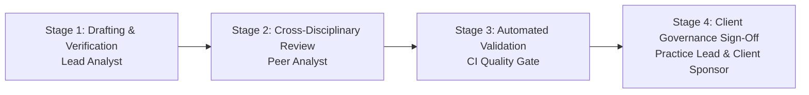

# Peer-Review and Document Approval Workflow

## 1. The Four-Stage Review Pipeline

---

## 2. Review Protocol Details
1. **Stage 1 (Drafting):** Author writes document or model, tagging any assumptions with `[PROPOSED]` or `[WORKING HYPOTHESIS]`.
2. **Stage 2 (Peer Review):**
   - Analyst 1 reviews Analyst 2's models for commercial logic and contractual feasibility.
   - Analyst 2 reviews Analyst 1's research and presentations for numerical accuracy.
3. **Stage 3 (Automated Quality Gate):**
   - Run `pytest tests/` and `python tools/validation/validate_repo.py`.
   - CI build must be green before PR merge.
4. **Stage 4 (Sign-Off):** Formal client approval recorded in `clients/<client>/approvals/approval-matrix.md`.
