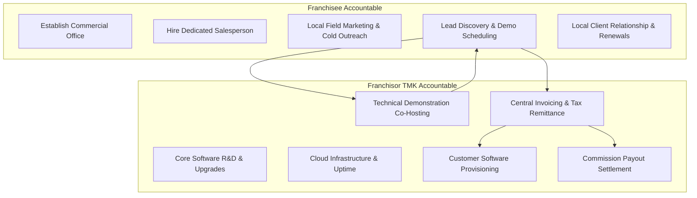

# TMK IT Solutions: FOFO Franchise Operating Model

## 1. Operating Concept
The commercial expansion of TMK IT Solutions LLP is structured upon a **Franchise Owned, Franchise Operated (FOFO) Hybrid Model**.

Under this model:
- The **Franchisee** acts as the localized commercial engine: funding the physical sales office, employing field sales personnel, establishing local institutional relationships, organizing live product demonstrations, and leading renewals.
- The **Franchisor (TMK Central)** acts as the centralized technology and delivery backbone: engineering the software, managing multi-tenant cloud hosting, providing technical demo support, delivering customer implementations, handling Level-2/3 technical helpdesk, and managing centralized customer billing.

---

## 2. Definitive Responsibility Division (RACI)

---

## 3. Minimum Franchisee Operational Requirements
To qualify for and maintain a TMK franchise territory, the franchisee must commit to:
1. **Dedicated Commercial Premises:** Minimum 200 sq. ft. commercial office space located in an accessible business or education district within the designated Taluka.
2. **Dedicated Personnel:** Minimum one full-time dedicated sales executive exclusively focused on prospecting, demonstrating, and closing TMK software products.
3. **Mandatory Certification:** Completion and passing score by the salesperson in the 10-day TMK Product Certification Bootcamp.
4. **CRM Compliance:** All customer leads, meeting notes, and demonstration requests must be logged in TMK's central CRM system within 24 hours of occurrence.
5. **Solvency Reserve:** Proof of minimum 4 months working capital reserve (~₹1,40,000) to ensure business continuity during sales ramp-up.
