# TMK Franchise Onboarding Journey & 30-Day Launch Roadmap

## 1. Onboarding Timeline Overview

```mermaid
gantt
    title Franchisee 30-Day Onboarding Roadmap
    dateFormat  DD
    axisFormat  Day %d
    section Phase 1: Due Diligence & Legal
    Agreement Execution & Fee Settlement :01, 05
    section Phase 2: Training Bootcamp
    10-Day Intensive Product & Sales Training :06, 15
    Certification Assessment                 :15, 16
    section Phase 3: Setup & Enablement
    Office Inspection & Signage Verification :16, 20
    CRM Setup & Collateral Delivery          :20, 23
    section Phase 4: Launch & Co-Selling
    Official Territory Launch                :24, 25
    First 10 Joint Customer Demos            :25, 30
```

---

## 2. Phase-by-Phase Execution

### Days 1–5: Due Diligence, Agreement & Territory Lock
- Submission of franchisee KYC documents, commercial lease copy, and trade license.
- Execution of Franchise Agreement and settlement of the joining fee.
- Assignment of official Taluka administrative code and territory lock in central database.

### Days 6–15: Product Certification Bootcamp
- Daily 3-hour virtual or classroom training led by TMK product engineering leads.
- In-depth module coverage: School ERP fee workflows, Invoicing GST filing, OMR scanner calibration, Property ERP dues reconciliation, DevOps architecture, and Sales CRM pipeline management.
- Day 15: Mandatory Certification Exam (80% passing grade required for dedicated salesperson).

### Days 16–23: Office Inspection & Collateral Delivery
- Photo inspection of commercial office signage, branded reception, and hardware.
- Provisioning of TMK central CRM credentials, email IDs, and demo tenant sandboxes.
- Dispatch of 500 physical brochures, pull-up banners, and sales proposal templates.

### Days 24–30: Field Launch & Co-Selling
- Franchisee launches localized digital and direct outreach across target institutions.
- TMK assigned Solution Architect co-hosts first 10 live customer demonstrations to guarantee high closing conversion.
