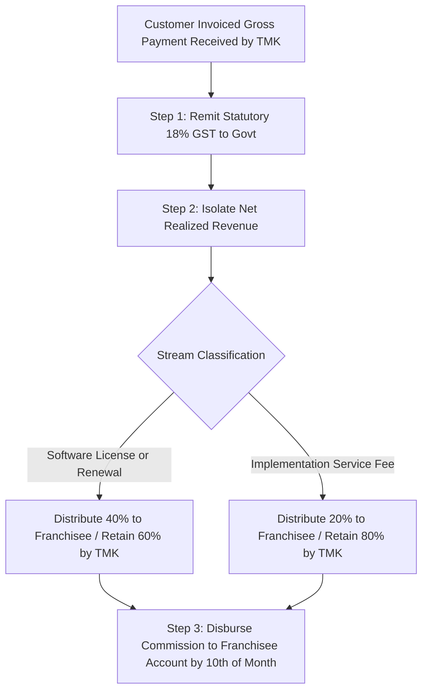

# TMK Revenue-Sharing Policy & Settlement Rules

## 1. Core Revenue-Sharing Matrix

| Revenue Stream Category | Franchisee Share (%) | Franchisor TMK Share (%) | Tax Treatment | Settlement Timing |
|---|---|---|---|---|
| **New Software License Acquisition** | **40.0%** | **60.0%** | Computed on Net Revenue (Excl. 18% GST) | Monthly (10th of following month) |
| **Annual Software Subscription Renewal** | **40.0%** | **60.0%** | Computed on Net Revenue (Excl. 18% GST) | Monthly (Upon customer renewal payment) |
| **Software Implementation & Setup Service** | **20.0%** | **80.0%** | Computed on Net Service Fee | Upon verified customer sign-off |
| **Third-Party Consumables / WhatsApp API** | **0.0%** (Pass-Through) | **100.0%** (Offset Costs) | At Cost to Customer | Monthly |

---

## 2. Settlement Mechanics & Waterfall Sequence

---

## 3. Special Commercial Clauses
1. **Direct Corporate Lead Attribution:** If a customer reaches out directly to TMK corporate headquarters but is physically located within an exclusive franchisee taluka:
   - If the lead is forwarded to the franchisee who leads discovery and closure: Franchisee receives full 40% commission.
   - If TMK central sales team closes the customer directly with zero franchisee involvement: Franchisee receives a 15% territory recognition override commission.
2. **Clawback on Refunds:** If a customer invokes the 30-day money-back guarantee, the 40% commission credited to the franchisee is debited on the next monthly settlement statement.
