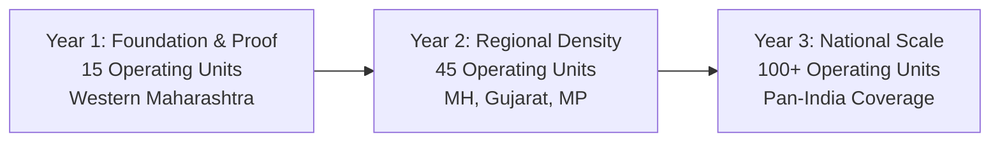

# TMK Franchise Network: Three-Year Strategic Growth Vision

## 1. Executive Expansion Roadmap

---

## 2. Milestone Targets Across Growth Phases

| Milestone Parameter | Phase 1 (Year 1) | Phase 2 (Year 2) | Phase 3 (Year 3) |
|---|---|---|---|
| **Active Franchise Operating Units** | **15 Units** | **45 Units** | **100+ Units** |
| **Geographic Footprint** | Western Maharashtra (Pune, Satara, Nashik, Kolhapur) | Maharashtra, South Gujarat, Madhya Pradesh | Pan-India (Major Education & Industrial Corridors) |
| **Cumulative Active Software Customers** | ~450 Institutions | ~1,800 Institutions | ~5,500+ Institutions |
| **Network Gross Customer Billings** | ₹2.2 Crores | ₹9.5 Crores | ₹30.0+ Crores |
| **Total Franchise Commissions Disbursed** | **₹88 Lakhs** | **₹3.8 Crores** | **₹12.0+ Crores** |
| **Franchise Support Ratio** | 1 Central Engineer : 5 Units | 1 Central Engineer : 8 Units | 1 Central Engineer : 10 Units |

---

## 3. The Compounding Advantage for Franchise Partners
Franchise partners joining during Wave 1 secure primary high-density Talukas with first-right-of-refusal for adjacent expansion. By Year 3, a dedicated franchise office managing 100+ active software subscribers generates over ₹8,00,000 annually in recurring renewal commissions alone, independent of new license sales.
