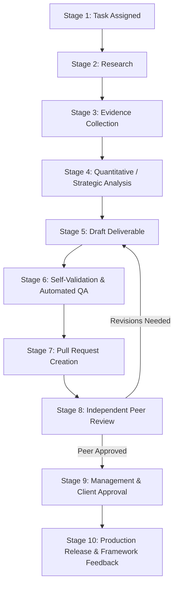

# Standard Work Journey: The 10-Stage Contribution Lifecycle

This document defines the authoritative, repeatable workflow governing how business analysis, research documents, financial models, and code contributions move from initial task assignment to production release across the **Franchise Business Modeling & Intelligence Platform**.

---

## 1. Lifecycle Overview Diagram



---

## 2. Stage-by-Stage Breakdown

| Stage | Stage Name | Primary Owner | Key Activities & Tools | Target Output Location | Registers Updated | Quality Gate / Check |
|---|---|---|---|---|---|---|
| **1** | **Task Assigned** | Lead / Analyst | Review sprint backlog, verify acceptance criteria, move card to *In Progress*. | Local branch (`git checkout -b <branch>`) | [task-board.md](file:///d:/company/products/franchise-business-platform/analyst-workspace/task-tracker/task-board.md) | Task scope clarity, verified prerequisite completion. |
| **2** | **Research** | Assigned Analyst | Review relevant frameworks, industry models, and competitor benchmarks. | Working notes in `/scratch/` | N/A | Framework alignment check. |
| **3** | **Evidence Collection** | Assigned Analyst | Identify primary empirical sources (government census, trade reports, pricing filings). | Structured citations | [research-evidence-register.md](file:///d:/company/products/franchise-business-platform/analyst-workspace/research-methodology/research-evidence-register.md) | Zero unverified claims rule; assign `EVD-*` ID. |
| **4** | **Analysis** | Assigned Analyst | Formulate qualitative arguments or execute Python calculations. | Model scripts, drafts | [assumptions-register.md](file:///d:/company/products/franchise-business-platform/analyst-workspace/research-methodology/assumptions-register.md) | Tag assumptions (`[PROPOSED]`, `[WORKING HYPOTHESIS]`). |
| **5** | **Draft Deliverable** | Assigned Analyst | Instantiate standardized markdown template or financial model code. | `clients/<client>/<domain>/` | Deliverable header tag (`[DRAFT]`) | Template compliance, `file:///` link formatting. |
| **6** | **Self-Validation** | Assigned Analyst | Run automated test suite, schema checks, and repository validator locally. | CLI terminal output | N/A | `pytest tests/` 100% green; `validate_repo.py` 0 errors. |
| **7** | **Pull Request** | Assigned Analyst | Push branch, open PR on GitHub, fill out PR description template. | GitHub PR | [task-board.md](file:///d:/company/products/franchise-business-platform/analyst-workspace/task-tracker/task-board.md) (Move to *Peer Review*) | Automated GitHub Actions CI pipeline passes. |
| **8** | **Peer Review** | Counterpart Analyst | Cross-disciplinary audit (Analyst 1 audits finance; Analyst 2 audits strategy). | PR comments & review notes | [task-board.md](file:///d:/company/products/franchise-business-platform/analyst-workspace/task-tracker/task-board.md) | [PR review checklist](file:///d:/company/products/franchise-business-platform/analyst-workspace/quality-checklists/pull-request-review-checklist.md) signed off. |
| **9** | **Management Approval** | Client Lead / Principal | Formal commercial and executive ratification. | Sign-off record | [approval-matrix.md](file:///d:/company/products/franchise-business-platform/clients/tmk-it-solutions/approvals/approval-matrix.md) | Formal client milestone sign-off. |
| **10**| **Release & Feedback** | Lead / Both Analysts | Merge to `main`, archive release tag, backport generic insights to `frameworks/`. | `clients/<client>/deliverables/` & `frameworks/` | [CHANGELOG.md](file:///d:/company/products/franchise-business-platform/CHANGELOG.md) | Deliverable header changed to `[APPROVED DELIVERABLE]`. |

---

## 3. Detailed Stage Explanations

### Stage 1: Task Assignment
Tasks are maintained in [analyst-workspace/task-tracker/task-board.md](file:///d:/company/products/franchise-business-platform/analyst-workspace/task-tracker/task-board.md). When starting a task:
1. Verify prerequisites in the task card.
2. Update the status column from `Backlog` to `In Progress`.
3. Create a feature branch following naming conventions:
   - For Analyst 1: `git checkout -b feat/strategy-<task-slug>`
   - For Analyst 2: `git checkout -b feat/finance-<task-slug>`

### Stage 2 & 3: Research and Evidence Collection
- **The Zero-Fabrication Rule:** Never invent a customer count, market size, growth rate, or competitor price.
- If a statistic is collected, enter it in [research-evidence-register.md](file:///d:/company/products/franchise-business-platform/analyst-workspace/research-methodology/research-evidence-register.md) with Source, Date, Credibility Tier, and assigned `EVD-*` ID.
- If an exact empirical figure is unobtainable, enter an explicit hypothesis in [assumptions-register.md](file:///d:/company/products/franchise-business-platform/analyst-workspace/research-methodology/assumptions-register.md).

### Stage 4 & 5: Analysis and Draft Deliverable
- Copy the relevant template from `templates/` into the client workspace.
- Replace all `{{...}}` placeholders with validated client specifics.
- Mark the document status header clearly: `[DRAFT]` or `[WORKING DISCUSSION DRAFT]`.
- Ensure all file links use the clickable `file:///` markdown syntax.

### Stage 6: Self-Validation & Automated QA
Before pushing changes or opening a pull request, the analyst must run the complete local verification suite:
```bash
# 1. Run unit test suite:
python -m pytest tests/ -v

# 2. Run repository integrity and schema validator:
python tools/validation/validate_repo.py
```
If any error occurs (broken link, schema mismatch, or math regression), it must be fixed immediately. Zero failures are tolerated.

### Stage 7 & 8: Pull Request Creation and Dual-Analyst Peer Review
- Open a GitHub pull request targeting `main`.
- Fill out the PR template, linking the relevant task ID and listing test outputs.
- Assign the counterpart analyst as reviewer.
  - **Analyst 1** deliverables (strategy, brochures, agreements) are audited by **Analyst 2** for numerical realism, fee alignment, and financial feasibility.
  - **Analyst 2** deliverables (financial engine, P&L forecasts, Excel sheets) are audited by **Analyst 1** for contractual compliance, commercial narrative alignment, and RACI harmony.
- Revisions are addressed directly on the feature branch. Once satisfied, the reviewer marks the PR `[PEER APPROVED]`.

### Stage 9: Management and Client Approval
- The deliverable is submitted to client leadership and senior partners.
- Upon formal sign-off, the approval status in `clients/<client-slug>/approvals/approval-matrix.md` is updated from `Pending Review` to `Approved`.
- The document header is upgraded to `[APPROVED DELIVERABLE]`.

### Stage 10: Production Release & Framework Feedback Loop
- **Deliverable Finalization:** Approved documents are tagged and committed to `clients/<client-slug>/deliverables/`.
- **Framework Feedback Loop:** If solving a client-specific challenge created a new reusable methodology (e.g., a new territory scoring metric or multi-tier renewal rule), the analyst generalizes the concept, strips all client confidential data, and updates the relevant generic framework in `frameworks/`.
- **Changelog:** Log all releases and framework enhancements in [CHANGELOG.md](file:///d:/company/products/franchise-business-platform/CHANGELOG.md).

---

## 4. Concrete Walkthrough 1: Analyst 1 (Business Strategy)

### Scenario: Authoring TMK's School Management System Market Brief
1. **Task Assigned:** Analyst 1 picks task `TASK-A1-03` ("School ERP Market Brief") from `task-board.md`. Creates branch `feat/strategy-school-erp-brief`.
2. **Research & Evidence:** Searches Indian Ministry of Education (UDISE+) data and regional school association reports.
3. **Evidence Log:** Adds entry `EVD-MKT-005` in `research-evidence-register.md`: "Over 12,000 private un-aided schools operate across Maharashtra Tier-2/3 talukas."
4. **Analysis:** Sizes TAM (12,000 schools * ₹30,000 = ₹36 Crore) and SOM (2% target = 240 schools = ₹72 Lakhs).
5. **Draft Deliverable:** Instantiates `templates/market-research/market-research-report.template.md` as `clients/tmk-it-solutions/research/school-management-market-brief.md`. Tags header as `[DRAFT]`.
6. **Self-Validation:** Runs `pytest tests/` and `python tools/validation/validate_repo.py`. Both return green.
7. **Pull Request:** Opens PR #104 with complete description.
8. **Peer Review:** Analyst 2 reviews PR #104. Confirms that the ₹30,000 software license price matches `prd-02-school-management` in `products-catalog.json`. Approves PR.
9. **Management Approval:** TMK Managing Partner reviews and approves brief in `approval-matrix.md`.
10. **Release & Feedback:** Deliverable is merged. Analyst 1 notes that private school pricing patterns can inform `industry-models/education/` and updates the generic education model.

---

## 5. Concrete Walkthrough 2: Analyst 2 (Financial Modeling)

### Scenario: Building 36-Month Sensitivity Scenarios for TMK IT Solutions
1. **Task Assigned:** Analyst 2 picks task `TASK-A2-04` ("Multi-Scenario Financial Sensitivity") from `task-board.md`. Creates branch `feat/finance-sensitivity-scenarios`.
2. **Research:** Reviews `frameworks/financial-modeling/financial-modeling-standards.md` for scenario definitions.
3. **Evidence Collection:** References `EVD-FIN-001` in `research-evidence-register.md` for historical B2B software churn rates (15%–20%).
4. **Analysis & Assumptions:** Configures `conservative` (1.5 units/mo, 60% renewal), `base` (3 units/mo, 80% renewal), and `optimistic` (5.5 units/mo, 90% renewal) in `clients/tmk-it-solutions/financial-models/assumptions.json`.
5. **Draft Deliverable:** Executes Python calculation engine:
   ```bash
   python tools/financial-modeling/cli.py --client tmk-it-solutions --scenario base
   python tools/financial-modeling/cli.py --client tmk-it-solutions --generate-excel
   ```
6. **Self-Validation:** Runs automated test suite:
   ```bash
   python -m pytest tests/ -v
   python tools/validation/validate_repo.py
   ```
   Zero errors, 100% green.
7. **Pull Request:** Opens PR #105 attaching console logs and Excel generation summary.
8. **Peer Review:** Analyst 1 audits PR #105. Verifies that CapEx line items match the office space requirements defined in the FOFO specification. Confirms statutory GST isolation. Approves PR.
9. **Management Approval:** CFO and Client Leadership approve financial model in `approval-matrix.md`.
10. **Release & Feedback:** Model is tagged as approved. Analyst 2 extracts the dynamic Excel generator formula logic into `frameworks/financial-modeling/` for future clients.

---

## 6. How Final Deliverables Are Protected

Approved client deliverables represent contractual and commercial truth:
- Located strictly in `clients/<client-slug>/deliverables/`.
- Must never be overwritten, renamed, or modified without a formal RFC and executive sign-off logged in `clients/<client-slug>/decisions/`.
- If an update is required, create a new versioned file (e.g., `tmk-prospectus-v1.1.md`) and log deprecation in `approval-matrix.md`.
