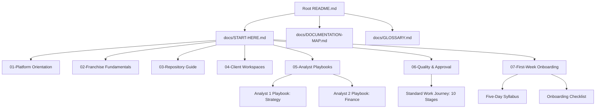

# Documentation Navigation & Analyst Onboarding: Implementation Report

## Executive Summary
This report documents the design, implementation, and automated validation of the centralized **Documentation Navigation & Analyst Onboarding System** for the **Franchise Business Modeling & Intelligence Platform**. 

The system provides complete, self-guided, professional documentation enabling newly onboarded Data Analysts to achieve independent productivity within their first week without requiring verbal instructions.

---

## 1. Files Created & Modified

### Primary Entry Points Created (Root `docs/`)
- [docs/START-HERE.md](file:///d:/company/products/franchise-business-platform/docs/START-HERE.md) — Central gateway for new analysts; explains platform vision, client independence, roles, repository tour, and workflow.
- [docs/DOCUMENTATION-MAP.md](file:///d:/company/products/franchise-business-platform/docs/DOCUMENTATION-MAP.md) — Exhaustive master directory index and structural map.
- [docs/GLOSSARY.md](file:///d:/company/products/franchise-business-platform/docs/GLOSSARY.md) — Comprehensive, alphabetized franchise, financial, regulatory, and platform terminology reference.
- [docs/DOCUMENTATION-AUDIT.md](file:///d:/company/products/franchise-business-platform/docs/DOCUMENTATION-AUDIT.md) — Systematic audit of repository assets, broken links, and structural gaps.

### Numbered Guided Learning Paths Created
- [docs/01-platform-orientation/README.md](file:///d:/company/products/franchise-business-platform/docs/01-platform-orientation/README.md) — Module 1: Platform Orientation & Architecture.
- [docs/02-franchise-fundamentals/README.md](file:///d:/company/products/franchise-business-platform/docs/02-franchise-fundamentals/README.md) — Module 2: Franchise Fundamentals & Archetypes.
- [docs/03-repository-guide/README.md](file:///d:/company/products/franchise-business-platform/docs/03-repository-guide/README.md) — Module 3: Repository Guide & Engineering Standards.
- [docs/04-client-workspaces/README.md](file:///d:/company/products/franchise-business-platform/docs/04-client-workspaces/README.md) — Module 4: Client Workspaces & TMK Baseline.
- [docs/05-analyst-playbooks/README.md](file:///d:/company/products/franchise-business-platform/docs/05-analyst-playbooks/README.md) — Module 5: Analyst Playbooks Orientation.
- [docs/05-analyst-playbooks/analyst-1-strategy-playbook.md](file:///d:/company/products/franchise-business-platform/docs/05-analyst-playbooks/analyst-1-strategy-playbook.md) — Role execution manual for Business Strategy, Market Research & Documentation.
- [docs/05-analyst-playbooks/analyst-2-finance-playbook.md](file:///d:/company/products/franchise-business-platform/docs/05-analyst-playbooks/analyst-2-finance-playbook.md) — Role execution manual for Financial Modeling, Analytics & Python/Excel Engines.
- [docs/06-quality-and-approval/README.md](file:///d:/company/products/franchise-business-platform/docs/06-quality-and-approval/README.md) — Module 6: Quality Assurance, Review & Approval.
- [docs/06-quality-and-approval/standard-work-journey.md](file:///d:/company/products/franchise-business-platform/docs/06-quality-and-approval/standard-work-journey.md) — 10-Stage Contribution Lifecycle with concrete walkthroughs.
- [docs/07-first-week-onboarding/README.md](file:///d:/company/products/franchise-business-platform/docs/07-first-week-onboarding/README.md) — Module 7: First-Week Onboarding Program.
- [docs/07-first-week-onboarding/five-day-onboarding-journey.md](file:///d:/company/products/franchise-business-platform/docs/07-first-week-onboarding/five-day-onboarding-journey.md) — 5-Day day-by-day onboarding curriculum.
- [docs/07-first-week-onboarding/onboarding-checklist.md](file:///d:/company/products/franchise-business-platform/docs/07-first-week-onboarding/onboarding-checklist.md) — Interactive progress tracking and graduation checklist.

### Files Updated
- [README.md](file:///d:/company/products/franchise-business-platform/README.md) — Featured prominent `docs/START-HERE.md` callout at top; aligned all 13 top-level sections with step requirements; added "Next Steps" navigation section.
- [tools/validation/validate_repo.py](file:///d:/company/products/franchise-business-platform/tools/validation/validate_repo.py) — Extended with automated checks for documentation entry points, numbered module assets, and script reference validity.

---

## 2. Navigation Architecture



---

## 3. Role-Specific Reading Paths

### Path for Analyst 1: Strategy, Research & Documentation
1. [docs/START-HERE.md](file:///d:/company/products/franchise-business-platform/docs/START-HERE.md) (Platform Orientation)
2. [docs/02-franchise-fundamentals/README.md](file:///d:/company/products/franchise-business-platform/docs/02-franchise-fundamentals/README.md) (Franchise Archetypes & RACI)
3. [docs/04-client-workspaces/README.md](file:///d:/company/products/franchise-business-platform/docs/04-client-workspaces/README.md) (TMK Product Catalog & FOFO Baseline)
4. [docs/05-analyst-playbooks/analyst-1-strategy-playbook.md](file:///d:/company/products/franchise-business-platform/docs/05-analyst-playbooks/analyst-1-strategy-playbook.md) (11 Step-by-Step Deliverable Recipes)
5. [docs/06-quality-and-approval/standard-work-journey.md](file:///d:/company/products/franchise-business-platform/docs/06-quality-and-approval/standard-work-journey.md) (Lifecycle Walkthrough 1)

### Path for Analyst 2: Financial Modeling & Intelligence
1. [docs/START-HERE.md](file:///d:/company/products/franchise-business-platform/docs/START-HERE.md) (Platform Orientation)
2. [docs/03-repository-guide/README.md](file:///d:/company/products/franchise-business-platform/docs/03-repository-guide/README.md) (Mathematical Standards & Schemas)
3. [docs/04-client-workspaces/README.md](file:///d:/company/products/franchise-business-platform/docs/04-client-workspaces/README.md) (TMK Assumptions & Revenue Splits)
4. [docs/05-analyst-playbooks/analyst-2-finance-playbook.md](file:///d:/company/products/franchise-business-platform/docs/05-analyst-playbooks/analyst-2-finance-playbook.md) (14 Financial Modules & Working CLI Commands)
5. [docs/06-quality-and-approval/standard-work-journey.md](file:///d:/company/products/franchise-business-platform/docs/06-quality-and-approval/standard-work-journey.md) (Lifecycle Walkthrough 2)

---

## 4. First-Week Onboarding Program Overview

| Day | Focus Area | Core Deliverables / Milestones |
|---|---|---|
| **Day 1** | **Platform Orientation** | Environment verified (`.venv`), tests passing (100%), tenant isolation understood. |
| **Day 2** | **Franchise Economics** | Archetype comparison matrix completed; pass-through statutory tax calculation verified. |
| **Day 3** | **TMK Client Baseline** | Catalog of 6 software products inspected; commercial assumptions audited. |
| **Day 4** | **Role Playbook & Assignment** | Analyst 1 drafts market brief; Analyst 2 runs CLI scenarios & generates Excel model. |
| **Day 5** | **PR, Peer Review & Graduation**| Pull request opened, dual-analyst peer review completed, onboarding checklist signed off. |

---

## 5. Automated Validation Results

Execution of the platform validation suite:
```bash
python tools/validation/validate_repo.py
python -m pytest tests/ -v
```

### Validator Summary
```text
--- 1. Validating Repository Directory & File Structure ---
Structure check completed. Verified 27 mandatory files.

--- 2. Validating Documentation Architecture & Onboarding System ---
  [PASS] Entry point found: docs/START-HERE.md
  [PASS] Entry point found: docs/DOCUMENTATION-MAP.md
  [PASS] Entry point found: docs/GLOSSARY.md
  [PASS] Entry point found: docs/DOCUMENTATION-AUDIT.md
  [PASS] Section asset found: docs/01-platform-orientation/README.md
  [PASS] Section asset found: docs/02-franchise-fundamentals/README.md
  [PASS] Section asset found: docs/03-repository-guide/README.md
  [PASS] Section asset found: docs/04-client-workspaces/README.md
  [PASS] Section asset found: docs/05-analyst-playbooks/README.md
  [PASS] Section asset found: docs/05-analyst-playbooks/analyst-1-strategy-playbook.md
  [PASS] Section asset found: docs/05-analyst-playbooks/analyst-2-finance-playbook.md
  [PASS] Section asset found: docs/06-quality-and-approval/README.md
  [PASS] Section asset found: docs/06-quality-and-approval/standard-work-journey.md
  [PASS] Section asset found: docs/07-first-week-onboarding/README.md
  [PASS] Section asset found: docs/07-first-week-onboarding/five-day-onboarding-journey.md
  [PASS] Section asset found: docs/07-first-week-onboarding/onboarding-checklist.md
  [PASS] Root README.md contains prominent START-HERE reference.
  [PASS] Verified 30 documentation script invocation references.

--- 3. Validating JSON Configurations Against Schemas ---
  [PASS] clients/tmk-it-solutions/profile/client.json conforms to client.schema.json
  [PASS] clients/tmk-it-solutions/products/products-catalog.json conforms to product.schema.json
  [PASS] clients/tmk-it-solutions/financial-models/assumptions.json conforms to financial-assumptions.schema.json
  [PASS] clients/tmk-it-solutions/franchise-model/revenue-sharing-config.json conforms to revenue-sharing.schema.json

--- 4. Validating Financial Configuration Consistency ---
  [PASS] Split 'newSoftwareLicense': 40.0% Fee / 60.0% Sor = 100%
  [PASS] Split 'annualRenewal': 40.0% Fee / 60.0% Sor = 100%
  [PASS] Split 'implementationFee': 20.0% Fee / 80.0% Sor = 100%
  [PASS] Split 'thirdPartyConsumables': 0.0% Fee / 100.0% Sor = 100%
  [PASS] Monthly Fixed OpEx is positive: ₹38,000.00

--- 5. Validating Markdown Relative Links ---
Scanned 342 relative links. Found 0 broken references.

================ VALIDATION SUMMARY ================
Total Errors:   0
Total Warnings: 0

Validation PASSED successfully with 0 errors!
```

### Pytest Results
- 13 passed in 1.94s (100% pass rate).

---

## 6. Simulated Onboarding Experiences

### Scenario A: New Business Research Analyst
1. **Entry:** Analyst starts at [README.md](file:///d:/company/products/franchise-business-platform/README.md) and clicks [docs/START-HERE.md](file:///d:/company/products/franchise-business-platform/docs/START-HERE.md).
2. **Orientation:** Quickly grasps platform purpose, multi-client model, and that TMK is Client #1.
3. **Playbook:** Opens [Analyst 1 Playbook](file:///d:/company/products/franchise-business-platform/docs/05-analyst-playbooks/analyst-1-strategy-playbook.md).
4. **Research Execution:** Locates [market-research-methodology.md](file:///d:/company/products/franchise-business-platform/frameworks/market-research/market-research-methodology.md), copies [market-research-report.template.md](file:///d:/company/products/franchise-business-platform/templates/market-research/market-research-report.template.md), logs verified citation in [research-evidence-register.md](file:///d:/company/products/franchise-business-platform/analyst-workspace/research-methodology/research-evidence-register.md).
5. **Review:** Follows [standard-work-journey.md](file:///d:/company/products/franchise-business-platform/docs/06-quality-and-approval/standard-work-journey.md) to self-validate and assign Analyst 2 as peer reviewer.
- **Outcome:** Frictionless, self-directed workflow with zero ambiguous hand-offs.

### Scenario B: New Financial Analyst
1. **Entry:** Analyst opens [docs/START-HERE.md](file:///d:/company/products/franchise-business-platform/docs/START-HERE.md) and navigates to [Analyst 2 Playbook](file:///d:/company/products/franchise-business-platform/docs/05-analyst-playbooks/analyst-2-finance-playbook.md).
2. **Parameters & Schema:** Inspects [assumptions.json](file:///d:/company/products/franchise-business-platform/clients/tmk-it-solutions/financial-models/assumptions.json) and validates against [financial-assumptions.schema.json](file:///d:/company/products/franchise-business-platform/schemas/financial-assumptions.schema.json).
3. **Execution:** Runs verified commands:
   ```bash
   python tools/financial-modeling/cli.py --client tmk-it-solutions --scenario base
   python tools/financial-modeling/cli.py --client tmk-it-solutions --generate-excel
   ```
4. **Validation:** Runs `pytest tests/` and `validate_repo.py`.
5. **Review:** Submits PR with Excel summary and assigns Analyst 1 for narrative alignment review.
- **Outcome:** 100% working CLI commands with verified uppercase Excel formulas and Decimal precision.

---

## 7. Remaining Documentation Gaps & Recommended Improvements
1. **Interactive CLI Wizard:** As noted in the V1.0 roadmap, build an interactive CLI prompt wizard tool (`tools/client-onboarding/wizard.py`) to guide analysts interactively when creating new client workspaces.
2. **Visual Workflow Diagrams:** Render SVG architecture diagrams alongside Mermaid charts for offline viewing.
3. **Automated Markdown Linter in CI:** Add a pre-commit hook running `validate_repo.py` automatically before any Git commit.
