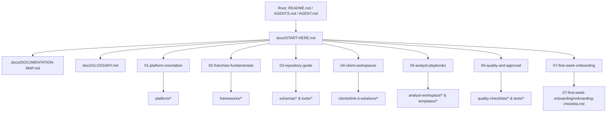

# Master Documentation Map & Repository Index

## 1. Visual Documentation Architecture

---

## 2. Master Navigation Index

### 2.1. Primary Entry Points
- [START-HERE.md](file:///d:/company/products/franchise-business-platform/docs/START-HERE.md): The primary onboarding portal for all incoming analysts.
- [DOCUMENTATION-MAP.md](file:///d:/company/products/franchise-business-platform/docs/DOCUMENTATION-MAP.md): This visual sitemap and asset directory.
- [GLOSSARY.md](file:///d:/company/products/franchise-business-platform/docs/GLOSSARY.md): Complete franchise business and financial modeling terminology dictionary.
- [DOCUMENTATION-AUDIT.md](file:///d:/company/products/franchise-business-platform/docs/DOCUMENTATION-AUDIT.md): Comprehensive inventory and audit of repository assets.

### 2.2. Seven-Module Guided Learning Paths
1. [01-platform-orientation/README.md](file:///d:/company/products/franchise-business-platform/docs/01-platform-orientation/README.md): Vision, multi-tenant architecture, and client-independence axiom.
2. [02-franchise-fundamentals/README.md](file:///d:/company/products/franchise-business-platform/docs/02-franchise-fundamentals/README.md): Archetypes (FOFO, FOCO, COCO, etc.), RACI matrices, unit economics, and investor protection.
3. [03-repository-guide/README.md](file:///d:/company/products/franchise-business-platform/docs/03-repository-guide/README.md): Codebase anatomy, Git branching workflow, Conventional Commits, and JSON schema data contracts.
4. [04-client-workspaces/README.md](file:///d:/company/products/franchise-business-platform/docs/04-client-workspaces/README.md): Client data isolation principles, client onboarding, and deep-dive tour of TMK IT Solutions LLP.
5. [05-analyst-playbooks/README.md](file:///d:/company/products/franchise-business-platform/docs/05-analyst-playbooks/README.md):
   - [Analyst 1 Playbook](file:///d:/company/products/franchise-business-platform/docs/05-analyst-playbooks/analyst-1-strategy-playbook.md): Strategy, market research, decks, agreements, operations.
   - [Analyst 2 Playbook](file:///d:/company/products/franchise-business-platform/docs/05-analyst-playbooks/analyst-2-finance-playbook.md): Financial engine, Excel models, break-even, sensitivity, dashboards.
6. [06-quality-and-approval/README.md](file:///d:/company/products/franchise-business-platform/docs/06-quality-and-approval/README.md):
   - [Standard Work Journey](file:///d:/company/products/franchise-business-platform/docs/06-quality-and-approval/standard-work-journey.md): 10-stage contribution lifecycle with concrete Analyst 1 and Analyst 2 walkthroughs.
7. [07-first-week-onboarding/README.md](file:///d:/company/products/franchise-business-platform/docs/07-first-week-onboarding/README.md):
   - [Five-Day Onboarding Journey](file:///d:/company/products/franchise-business-platform/docs/07-first-week-onboarding/five-day-onboarding-journey.md): Structured daily curriculum (Days 1–5).
   - [Onboarding Checklist](file:///d:/company/products/franchise-business-platform/docs/07-first-week-onboarding/onboarding-checklist.md): Interactive progress tracker.

---

### 2.3. Core Reusable Business Frameworks (`frameworks/`)
- [Franchise Archetypes Comparison & RACI](file:///d:/company/products/franchise-business-platform/frameworks/franchise-model-design/franchise-archetypes-comparison.md)
- [Financial Feasibility & Unit Economics](file:///d:/company/products/franchise-business-platform/frameworks/feasibility-analysis/financial-feasibility-framework.md)
- [Configurable Revenue Sharing & Settlement](file:///d:/company/products/franchise-business-platform/frameworks/revenue-sharing/configurable-revenue-sharing-framework.md)
- [Market Research Methodology (TAM/SAM/SOM)](file:///d:/company/products/franchise-business-platform/frameworks/market-research/market-research-methodology.md)
- [Territory Intelligence & Opportunity Scoring](file:///d:/company/products/franchise-business-platform/frameworks/territory-intelligence/territory-intelligence-framework.md)
- [Franchisee & Investor Protection](file:///d:/company/products/franchise-business-platform/frameworks/investor-protection/investor-protection-framework.md)
- [Risk Assessment & Mitigation Taxonomy](file:///d:/company/products/franchise-business-platform/frameworks/risk-assessment/risk-assessment-framework.md)
- [Operations Governance & Enablement](file:///d:/company/products/franchise-business-platform/frameworks/franchise-operations/operations-governance-framework.md)
- [Performance Analytics & 13 Core KPIs](file:///d:/company/products/franchise-business-platform/frameworks/performance-analytics/kpi-analytics-framework.md)
- [Network Expansion & Capacity Scaling](file:///d:/company/products/franchise-business-platform/frameworks/franchise-expansion/expansion-scaling-framework.md)
- [Financial Modeling Standards](file:///d:/company/products/franchise-business-platform/frameworks/financial-modeling/financial-modeling-standards.md)
- [Franchise Launch Readiness Framework](file:///d:/company/products/franchise-business-platform/frameworks/franchise-launch-readiness/franchise-launch-readiness-framework.md)
- [Launch Gates & Critical Blockers](file:///d:/company/products/franchise-business-platform/frameworks/franchise-launch-readiness/launch-gates-and-blockers.md)

---

### 2.4. Inaugural Client Workspace (`clients/tmk-it-solutions/`)
- [TMK Workspace Overview](file:///d:/company/products/franchise-business-platform/clients/tmk-it-solutions/README.md)
- Profile: [client.json](file:///d:/company/products/franchise-business-platform/clients/tmk-it-solutions/profile/client.json) | [Company Overview](file:///d:/company/products/franchise-business-platform/clients/tmk-it-solutions/profile/company-overview.md) | [Commercial Assumptions](file:///d:/company/products/franchise-business-platform/clients/tmk-it-solutions/profile/commercial-assumptions.md)
- Products: [Product Catalog JSON](file:///d:/company/products/franchise-business-platform/clients/tmk-it-solutions/products/products-catalog.json) | [School ERP](file:///d:/company/products/franchise-business-platform/clients/tmk-it-solutions/products/school-college-erp.md) | [Invoicing App](file:///d:/company/products/franchise-business-platform/clients/tmk-it-solutions/products/invoicing-app-web.md) | [OMR Software](file:///d:/company/products/franchise-business-platform/clients/tmk-it-solutions/products/omr-software.md) | [Property ERP](file:///d:/company/products/franchise-business-platform/clients/tmk-it-solutions/products/property-management-erp.md) | [DevOps Platform](file:///d:/company/products/franchise-business-platform/clients/tmk-it-solutions/products/devops-automation.md) | [Sales CRM](file:///d:/company/products/franchise-business-platform/clients/tmk-it-solutions/products/sales-crm.md)
- Franchise Model: [FOFO Model](file:///d:/company/products/franchise-business-platform/clients/tmk-it-solutions/franchise-model/fofo-operating-model.md) | [Fee Structure](file:///d:/company/products/franchise-business-platform/clients/tmk-it-solutions/franchise-model/fee-structure.md) | [Revenue Sharing Rules](file:///d:/company/products/franchise-business-platform/clients/tmk-it-solutions/franchise-model/revenue-sharing-rules.md) | [Territory Policy](file:///d:/company/products/franchise-business-platform/clients/tmk-it-solutions/franchise-model/territory-policy-draft.md)
- Financial Models: [Assumptions JSON](file:///d:/company/products/franchise-business-platform/clients/tmk-it-solutions/financial-models/assumptions.json) | [Projections Summary](file:///d:/company/products/franchise-business-platform/clients/tmk-it-solutions/financial-models/financial-projections-summary.md) | [Excel Workbook](file:///d:/company/products/franchise-business-platform/clients/tmk-it-solutions/financial-models/tmk_it_solutions_franchise_financial_model.xlsx)
- Pitch & Marketing: [Pitch Deck Spec](file:///d:/company/products/franchise-business-platform/clients/tmk-it-solutions/presentations/franchise-opportunity-pitch-deck.md) | [PowerPoint PPTX](file:///d:/company/products/franchise-business-platform/clients/tmk-it-solutions/presentations/franchise-opportunity-pitch-deck.pptx) | [Brochure](file:///d:/company/products/franchise-business-platform/clients/tmk-it-solutions/sales-marketing/franchise-brochure.md) | [Prospectus](file:///d:/company/products/franchise-business-platform/clients/tmk-it-solutions/sales-marketing/franchise-prospectus.md) | [FAQ](file:///d:/company/products/franchise-business-platform/clients/tmk-it-solutions/sales-marketing/franchise-faq.md)
- Working Legal Drafts: [Franchise Agreement](file:///d:/company/products/franchise-business-platform/clients/tmk-it-solutions/legal-drafts/franchise-agreement-draft.md) | [Revenue Policy](file:///d:/company/products/franchise-business-platform/clients/tmk-it-solutions/legal-drafts/revenue-sharing-policy-draft.md) | [Territory Policy](file:///d:/company/products/franchise-business-platform/clients/tmk-it-solutions/legal-drafts/territory-policy-draft.md) | [Renewal Policy](file:///d:/company/products/franchise-business-platform/clients/tmk-it-solutions/legal-drafts/franchise-renewal-policy-draft.md) | [Termination Policy](file:///d:/company/products/franchise-business-platform/clients/tmk-it-solutions/legal-drafts/franchise-termination-policy-draft.md) | [NDA](file:///d:/company/products/franchise-business-platform/clients/tmk-it-solutions/legal-drafts/confidentiality-agreement-draft.md) | [Brand Usage](file:///d:/company/products/franchise-business-platform/clients/tmk-it-solutions/legal-drafts/brand-usage-policy-draft.md)
- Launch Readiness: [Checklist JSON](file:///d:/company/products/franchise-business-platform/clients/tmk-it-solutions/launch-readiness/tmk-launch-readiness-checklist.json) | [Checklist Master Table](file:///d:/company/products/franchise-business-platform/clients/tmk-it-solutions/launch-readiness/tmk-launch-readiness-checklist.md) | [Gates Assessment](file:///d:/company/products/franchise-business-platform/clients/tmk-it-solutions/launch-readiness/tmk-launch-gates-assessment.md) | [Excel Tracker](file:///d:/company/products/franchise-business-platform/clients/tmk-it-solutions/launch-readiness/tmk_launch_readiness_tracker.xlsx) | [Coverage Report](file:///d:/company/products/franchise-business-platform/clients/tmk-it-solutions/launch-readiness/tmk-launch-coverage-report.md)

---

### 2.5. Analyst Workspace & Registers (`analyst-workspace/`)
- [Task Board](file:///d:/company/products/franchise-business-platform/analyst-workspace/task-tracker/task-board.md)
- [Analyst 1 Backlog](file:///d:/company/products/franchise-business-platform/analyst-workspace/assignments/analyst-1-backlog.md)
- [Analyst 2 Backlog](file:///d:/company/products/franchise-business-platform/analyst-workspace/assignments/analyst-2-backlog.md)
- [Research Evidence Register](file:///d:/company/products/franchise-business-platform/analyst-workspace/research-methodology/research-evidence-register.md)
- [Assumptions Register](file:///d:/company/products/franchise-business-platform/analyst-workspace/research-methodology/assumptions-register.md)
- [Pull Request Checklist](file:///d:/company/products/franchise-business-platform/analyst-workspace/quality-checklists/pull-request-review-checklist.md)
- [Deliverable Acceptance Checklist](file:///d:/company/products/franchise-business-platform/analyst-workspace/quality-checklists/deliverable-acceptance-checklist.md)
