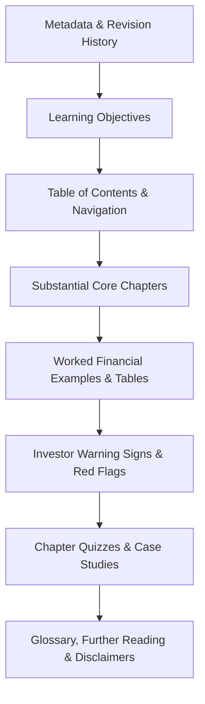

# Editorial Standards & Content Quality Guidelines
## Franchise Investor Academy — Publication Manual

**Document Version:** `1.0.0`  
**Classification:** Public Educational Framework  
**Authoritative Standard:** Aligned with [AGENTS.md](../../AGENTS.md) and [Investor Protection Framework](../../frameworks/investor-protection/investor-protection-framework.md)  
**Target Audience:** Authors, Peer Reviewers, Data Analysts, and Editors  

---

## 1. Core Educational Mission

The **Franchise Investor Academy** exists to provide objective, mathematically grounded, and legally sound business education for prospective franchise buyers. Franchising involves substantial capital risk. Our publications must equip investors with critical evaluation skills rather than promoting franchise opportunities as get-rich-quick schemes.

### Primary Directives
1. **Zero Promotional Bias:** The Academy is industry-agnostic and client-neutral. It must NEVER serve as a marketing funnel or promotional brochure for TMK IT Solutions LLP or any other platform client. Client references must be clearly labeled as illustrative case studies.
2. **No Deceptive Earnings Claims:** Never describe projected returns, scenario outputs, or cash flows as "guaranteed," "assured profit," "passive income," or "risk-free." 
3. **Mandatory Risk Disclosures:** Every chapter dealing with financial performance, unit economics, or contracts must carry explicit investor caution alerts explaining the factors that lead to business failure.
4. **Empirical Fact & Citation Integrity:** Do not invent market sizes, competitor metrics, adoption rates, or litigation statistics. All historical benchmarks must be sourced from verified registries or clearly designated as `[HYPOTHETICAL WORKED EXAMPLE]`.

---

## 2. Mandatory Structural Architecture for eBooks

Every volume in the 10-eBook series must follow a standardized 8-part anatomy:



### Required Front Matter & Metadata
- **Book Title & Subtitle:** Clear, actionable, and investor-oriented.
- **Series Identification:** Volume number (1–10) and Learning Path (Beginner / Intermediate / Advanced).
- **Publication Metadata:** Publication date, revision number, lead author role, and peer reviewer role.
- **Audience & Prerequisites:** Assumed reader experience level and recommended prerequisite reading.

### Required Chapter Anatomy
Each substantive chapter must contain:
1. **Chapter Title & Reading Time:** (e.g., *12 min read*).
2. **Learning Objectives:** 3 to 5 concrete outcomes using Bloom's taxonomy verbs (*evaluate, calculate, contrast, identify*).
3. **Core Conceptual Narrative:** Written in plain, accessible language suitable for first-time Indian business owners.
4. **Practical Tables & Comparison Frameworks:** At least one structured markdown table per major concept.
5. **Worked Numerical Illustration:** Step-by-step math with realistic figures in Indian Rupees (₹), showing taxes, margins, and deductions.
6. **Investor Warning Sign Alert Box:** Highlighted callout identifying deceptive franchisor practices or common rookie errors.
7. **Key Takeaways:** 3 to 5 bullet points summarizing actionable advice.
8. **Knowledge Check:** Multiple-choice quiz questions with complete explanatory answer keys.

---

## 3. Decimal-Safe Financial Standards & Worked Math

In accordance with Platform Rule 3, all financial illustrations must adhere to strict mathematical integrity:

1. **Tax Segregation:** In India, Goods and Services Tax (18% GST) is a statutory pass-through liability. All revenue splits, royalties, and commissions must be calculated on **Net Realized Revenue** (exclusive of GST), unless an explicit tax-inclusive agreement is modeled.
2. **Clear Labeling:** Every numerical example must state:
   - Base currency (INR ₹).
   - Tax assumption (e.g., *Net of 18% GST*).
   - Capital classification (CapEx, Working Capital, or Sunk Onboarding Fee).
3. **No Rounding Drift:** Math must be verifiable. Do not present round estimates that mask severe cash shortfalls.
4. **Payback & Break-Even Formulations:**
   - **Operational Break-Even (Units):**
     $$\text{Break-Even Units} = \frac{\text{Fixed Monthly Operating Costs (OpEx)}}{\text{Net Contribution Margin Per Unit}}$$
   - **Simple Payback Period:**
     $$\text{Payback (Months)} = \frac{\text{Total Upfront Capital Invested (CapEx + Working Capital Reserve)}}{\text{Net Monthly Free Cash Flow to Investor}}$$

---

## 4. Distinguishing Real Cases from Hypothetical Examples

To protect readers from misconstruing illustrative models as verified factual records:

- **Verified Historical Cases:** Must cite the primary source (court filing, regulatory order, published corporate annual report) with publication year and jurisdiction.
- **Hypothetical Educational Cases:** Must be explicitly labeled at the section header:
  > **[HYPOTHETICAL EDUCATIONAL CASE STUDY]**  
  > *The following business scenario, company names, and financial statements are synthetic constructs created solely for instructional purposes.*

---

## 5. Indian Legal & Regulatory Framing Standards

When discussing legal agreements, territorial rights, and investor protections in India:

1. **Statutory Anchors:** Accurately reference applicable Indian legislation:
   - Indian Contract Act, 1872 (Offer, acceptance, non-compete covenants, Section 27 restraint of trade).
   - Trade Marks Act, 1999 (Registered brand licensing, Class classifications, infringement vs passing off).
   - Arbitration and Conciliation Act, 1996 (Dispute resolution mechanisms, fast-track commercial arbitration).
   - Specific Relief Act, 1963 (Injunctions, performance enforcement).
   - Consumer Protection Act, 2019 (Unfair trade practices, false advertising standards).
2. **Mandatory Legal Disclaimer:**
   > [!IMPORTANT]
   > **Legal Disclaimer:** *The Franchise Investor Academy provides general educational information and commercial frameworks. It does NOT constitute legal, financial, or tax advice. Prospective franchise buyers in India must have franchise disclosure documents, territory policies, and master agreements independently audited by a qualified corporate attorney and practicing chartered accountant before executing contracts or remitting capital.*

---

## 6. Pre-Publication Editorial Review Checklist

Before any eBook or chapter is merged into `main`, it must receive check marks across all 20 editorial gates:

```text
[ ] 01. Neutral Tone: Free of promotional bias towards any specific client or company.
[ ] 02. Plain Language: Complex legal/financial jargon is translated into intuitive concepts.
[ ] 03. Defined Terms: Every technical term is defined upon first mention and included in GLOSSARY.md.
[ ] 04. Learning Objectives: Clear, measurable goals stated at the beginning of each chapter.
[ ] 05. Table of Contents: Complete, hyperlinked navigation matching file structure.
[ ] 06. Formatted Tables: Structured comparison matrices for all multi-option concepts.
[ ] 07. Sourced Evidence: Market claims and legal references cite verifiable statutory/industry sources.
[ ] 08. Synthetic Labeling: All hypothetical examples carry explicit educational case tags.
[ ] 09. Math Verification: All calculations manually cross-checked with zero arithmetic discrepancies.
[ ] 10. Tax Segregation: GST (18%) and statutory TDS deductions clearly isolated in financial flows.
[ ] 11. No Guaranteed Returns: Zero promises of guaranteed margins, payback speed, or effortless profit.
[ ] 12. Warning Signs: Includes prominent red-flag warnings and investor protection checklists.
[ ] 13. Knowledge Checks: Chapter quizzes include multiple-choice questions and explained answer keys.
[ ] 14. Actionable Tools: Includes downloadable/printable due diligence worksheets or decision trees.
[ ] 15. Relative Links: All internal links use relative markdown paths (e.g. ../book-02/...) with 0 broken references.
[ ] 16. Accessibility: Markdown tables, clean headings (H1 -> H2 -> H3), and alt text for all diagrams.
[ ] 17. Legal Disclaimer: Mandatory professional review warning box prominently displayed.
[ ] 18. Publication Metadata: Version number, release date, and change log documented in front matter.
[ ] 19. Dual-Analyst Sign-off: Strategy review (Analyst 1) and Financial review (Analyst 2) logged.
[ ] 20. Automated CI Pass: python tools/validation/validate_repo.py and pytest test suite return 100% green.
```
