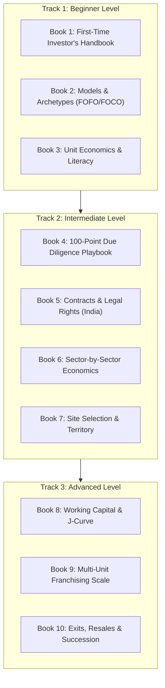

# Structured Learning Paths & Curriculum Guide
## Franchise Investor Academy — Multi-Tier Educational Program

**Version:** `1.0.0`  
**Classification:** Curriculum Architecture  
**Target Audience:** Prospective Franchise Buyers, Private Investors, and Advisory Consultants  

---

## 1. Curriculum Overview & Learning Philosophy

The **Franchise Investor Academy** organizes its 10-eBook library into three sequential, progressive learning tracks. Each tier is calibrated to match the investor's current stage of commercial readiness—from initial curiosity and conceptual evaluation to rigorous contract redlining and multi-unit portfolio management.

---

## 2. Track 1: Beginner Level — Foundations of Franchise Evaluation

### Target Investor Profile
- Salaried corporate professionals exploring business ownership.
- First-time entrepreneurs evaluating franchising vs. starting an independent startup.
- Family business members diversifying into modern retail, food, or service concepts.

### Learning Objectives
1. Understand the legal and economic relationship between franchisor and franchisee.
2. Differentiate between active operational involvement (FOFO) and passive investor structures (FOCO).
3. Compute basic unit economics: CapEx, fixed OpEx, gross margins, and operational break-even unit sales.
4. Recognize deceptive earnings promises, get-rich-quick claims, and predatory franchisor tactics.

### Assigned Books & Reading Sequence
1. **[Book 1: The First-Time Franchise Investor's Handbook](book-01-first-time-investor-handbook/README.md)** (6 Chapters + Quizzes + Case Study)
   - *Core Focus:* Franchise mechanics, debunking myths, selecting archetypes, estimating total capital, self-assessment, and initial red flags.
2. **[Book 2: Demystifying Franchise Business Models & Operating Archetypes](book-02-business-models-and-archetypes/README.md)**
   - *Core Focus:* Comprehensive breakdown of FOFO, FOCO, COCO, Master Franchise, and hybrid channel partnerships.
3. **[Book 3: Franchise Unit Economics & Financial Literacy for Investors](book-03-unit-economics-and-financial-literacy/README.md)**
   - *Core Focus:* Calculating contribution margins, isolating statutory 18% GST pass-through taxes, modeling 36-month P&Ls, and calculating simple payback.

### Mandatory Capstone Milestone
- Complete **Knowledge Check Exam 1** with $\ge 80\%$ score.
- Model the operational break-even unit sales and payback timeline for a sample ₹15.00 Lakh retail franchise opportunity using the provided Excel/Python templates.

---

## 3. Track 2: Intermediate Level — Due Diligence, Contracts & Sector Selection

### Target Investor Profile
- Active prospective buyers with liquid capital ready to deploy within 3 to 6 months.
- Investors who have identified 2 to 3 candidate franchise brands and are reviewing disclosure packets.
- Investors preparing to sign commercial leases or engage legal counsel.

### Learning Objectives
1. Execute the 100-Point Franchise Due Diligence Checklist across corporate, legal, and operational domains.
2. Audit draft Franchise Agreements under Indian Contract Act, 1872, identifying predatory clauses.
3. Contrast margin profiles, capital intensity, and failure modes across Food & Beverage, Retail, Education, Healthcare, and B2B Software.
4. Evaluate catchment demographics, commercial lease agreements, footfall counts, and territorial exclusivity rules.

### Assigned Books & Reading Sequence
4. **[Book 4: The 100-Point Franchise Due Diligence Playbook](book-04-due-diligence-playbook/README.md)**
   - *Core Focus:* Corporate background checks, executive background audits, interviewing existing and former franchisees, and mystery shopping protocols.
5. **[Book 5: Unpacking the Franchise Agreement & Legal Rights in India](book-05-franchise-agreements-and-legal-rights/README.md)**
   - *Core Focus:* Contract redlining, Section 27 non-compete enforceability, trademark licensing scope, dispute resolution, and unilateral termination clauses.
6. **[Book 6: Sector-by-Sector Franchise Economics](book-06-sector-by-sector-economics/README.md)**
   - *Core Focus:* Economic anatomy of 5 core verticals (F&B, Retail, Pre-schools, Diagnostics, Cloud Software) with comparative margin and CapEx profiles.
7. **[Book 7: Site Selection, Territory Intelligence & Real Estate Negotiation](book-07-site-selection-and-territory-intelligence/README.md)**
   - *Core Focus:* Footfall counting methodology, lease negotiations (lock-in, CAM charges), taluka boundary definitions, and anti-cannibalization protections.

### Mandatory Capstone Milestone
- Audit a real or sample franchise offering using the [100-Point Due Diligence Checklist](DUE_DILIGENCE_CHECKLIST.md) and produce a formal 4-page Investment Memo summarizing viability score and fatal red flags.

---

## 4. Track 3: Advanced Level — Operations, Scale & Multi-Unit Governance

### Target Investor Profile
- Existing franchise operators seeking to scale from single-unit to cluster operators (3 to 10+ units).
- High-Net-Worth Individuals (HNIs) and family offices negotiating Master Franchise or Area Development agreements.
- Multi-unit operators preparing 3- to 7-year exit, transfer, or succession strategies.

### Learning Objectives
1. Navigate the cash flow J-curve and structure dynamic working capital reserves during months 1 to 18.
2. Build cluster management systems, delegating daily store operations to regional area managers.
3. Optimize capital stacking using commercial term loans, equipment leasing, and internal cash flow reinvestment.
4. Value a going-concern franchise business for resale, negotiate franchisor transfer approvals, and execute succession planning.

### Assigned Books & Reading Sequence
8. **[Book 8: Working Capital Management & Franchise Cash Flow Survival](book-08-working-capital-and-cash-flow/README.md)**
   - *Core Focus:* Working capital decay, managing payroll and supplier credit, customer receivable collection cycles, and surviving zero-sales velocity periods.
9. **[Book 9: Multi-Unit Franchising & Empire Building](book-09-multi-unit-franchising/README.md)**
   - *Core Focus:* Area development agreements, cluster supervision economics, shared staffing efficiencies, and debt structuring.
10. **[Book 10: Franchise Exits, Resales, and Succession Planning](book-10-franchise-exits-and-resales/README.md)**
    - *Core Focus:* Valuation methodologies (EBITDA multiples), finding buyers, franchisor right-of-first-refusal (ROFR), de-branding protocols, and family estate transfers.

### Mandatory Capstone Milestone
- Design a 5-unit regional rollout and cluster financing plan, including a consolidated 36-month cash flow schedule and succession charter.

---

## 5. Comparative Learning Matrix

| Metric | Track 1: Beginner Level | Track 2: Intermediate Level | Track 3: Advanced Level |
|---|---|---|---|
| **Primary Goal** | Commercial Literacy & Feasibility | Brand Audit & Contract Protection | Cluster Operations & Portfolio Scale |
| **Volumes Covered** | Books 1, 2, and 3 | Books 4, 5, 6, and 7 | Books 8, 9, and 10 |
| **Estimated Study Time** | 8 – 12 Hours | 15 – 20 Hours | 12 – 15 Hours |
| **Recommended Background** | Zero Prior Experience | Exploring Active Brands | Operating $\ge 1$ Unit / HNI Investor |
| **Practical Tool** | Unit Break-Even Calculator | 100-Point Due Diligence Checklist | Multi-Unit Cash Flow & Valuation Engine |
| **Legal Focus** | Definition of Franchise License | Indian Contract Act & Agreements | Corporate Governance & Exit Deeds |
