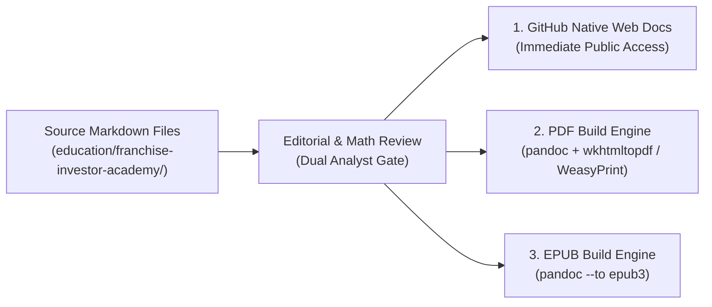

# Publication Workflow & Distribution Architecture
## Franchise Investor Academy — Multi-Format Release Guide

**Version:** `1.0.0`  
**Classification:** Technical Publishing Pipeline  
**Supported Output Formats:** Markdown (Web/GitHub), PDF (Printable), EPUB (eReader)  

---

## 1. Publishing Philosophy: Single-Source Authoring

The **Franchise Investor Academy** uses a **single-source of truth (SSOT)** authoring paradigm. All editorial content is authored, reviewed, version-controlled, and audited in GitHub Flavored Markdown (`.md`). 

From this single source, automated tools can generate:
1. **GitHub Native Repository View:** Immediate web accessibility directly inside the public GitHub repository with interlinked relative paths.
2. **Standardized PDF Compilations:** Formatted multi-page PDF documents with styled title pages, running headers, tables, and page numbers for investor distribution and printing.
3. **EPUB eBooks:** Standard reflowable eBooks for offline study on eReaders, tablets, and mobile devices (Apple Books, Kindle, Kobo).



---

## 2. Directory & Asset Standards

To enable automated compilation without broken image links or mismatched file references:

```text
education/franchise-investor-academy/
├── book-01-first-time-investor-handbook/
│   ├── README.md                              # Volume title, TOC & book metadata
│   ├── chapter-01-what-is-franchising.md      # Chapter source
│   ├── chapter-02-myths-vs-reality.md
│   ├── chapter-03-archetypes-and-models.md
│   ├── chapter-04-financial-mechanics.md
│   ├── chapter-05-investor-self-assessment.md
│   ├── chapter-06-red-flags-and-due-diligence.md
│   ├── quizzes-and-case-studies.md
│   └── assets/                                # Local SVGs, diagrams, charts
```

### Relative Linking Rules for Seamless Cross-Format Compatibility
1. **Never use absolute local paths:** Avoid `file:///` or hardcoded drive paths (`D:\...`).
2. **Use relative markdown links (syntax guidelines for chapter authors):**
   - Intra-book references: `[Chapter Title](chapter-xx-name.md)`
   - Sibling volume references: `[Sibling Book](../book-xx-name/README.md)`
   - Academy-level tool references: `[Checklist Tool](../DUE_DILIGENCE_CHECKLIST.md)`
   - Platform repository root references: `[Root README](../../README.md)`
3. **Mermaid Diagrams:** Include ASCII or standard markdown fallback tables so text-only renderers retain complete informational clarity.

---

## 3. PDF & EPUB Compilation Instructions

When compiling markdown chapters into unified PDF and EPUB eBooks, use the standardized Pandoc commands detailed below.

### 3.1. Prerequisites
Ensure the following build tools are installed on the local system or CI runner:
```bash
# Verify Pandoc installation:
pandoc --version

# Verify PDF engine (e.g. pdflatex, xelatex, or wkhtmltopdf):
wkhtmltopdf --version
```

### 3.2. Compiling a Unified Volume to PDF
To compile an entire eBook volume into a single print-ready PDF:

```bash
# Example: Compiling Book 1
cd education/franchise-investor-academy/book-01-first-time-investor-handbook

pandoc \
  README.md \
  chapter-01-what-is-franchising.md \
  chapter-02-myths-vs-reality.md \
  chapter-03-archetypes-and-models.md \
  chapter-04-financial-mechanics.md \
  chapter-05-investor-self-assessment.md \
  chapter-06-red-flags-and-due-diligence.md \
  quizzes-and-case-studies.md \
  -o book-01-first-time-investor-handbook.pdf \
  --pdf-engine=weasyprint \
  --toc \
  --toc-depth=2 \
  --metadata title="The First-Time Franchise Investor's Handbook" \
  --metadata author="Franchise Business Modeling & Intelligence Platform" \
  --metadata date="October 2026"
```

### 3.3. Compiling a Unified Volume to EPUB
To generate an eReader-compatible EPUB3 publication:

```bash
cd education/franchise-investor-academy/book-01-first-time-investor-handbook

pandoc \
  README.md \
  chapter-01-what-is-franchising.md \
  chapter-02-myths-vs-reality.md \
  chapter-03-archetypes-and-models.md \
  chapter-04-financial-mechanics.md \
  chapter-05-investor-self-assessment.md \
  chapter-06-red-flags-and-due-diligence.md \
  quizzes-and-case-studies.md \
  -o book-01-first-time-investor-handbook.epub \
  --to epub3 \
  --toc \
  --toc-depth=2 \
  --metadata title="The First-Time Franchise Investor's Handbook" \
  --metadata author="Franchise Business Modeling & Intelligence Platform" \
  --metadata lang="en-IN"
```

---

## 4. Release Tagging & Version Control

All eBooks follow semantic versioning (`MAJOR.MINOR.PATCH`):
- **MAJOR (1.0.0):** Complete, fully reviewable volume with all chapters, quizzes, and financial models.
- **MINOR (0.2.0):** Significant structural expansion (e.g. adding 2 new chapters or updating major case studies).
- **PATCH (0.1.1):** Minor typo fixes, broken link repairs, or numerical formatting clarifications.

### Revision Log Table
Every volume must maintain an audit table in its `README.md`:

| Version | Release Date | Summary of Changes | Lead Author | Peer Reviewer |
|---|---|---|---|---|
| `v1.0.0` | 2026-10-26 | Initial complete release of Volume 1 | Analyst 1 | Analyst 2 |
| `v0.1.0` | 2026-10-26 | Initial curriculum structure & starter chapters | Analyst 1 | Analyst 2 |
