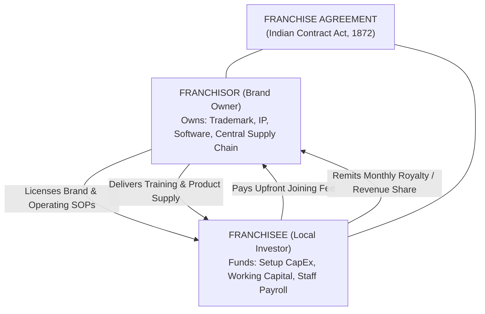

# Chapter 1: The Foundations of Franchising — Licensing, Systems & Contracts
## Volume 1: The First-Time Franchise Investor's Handbook

*Reading Time: 14 minutes*  
**Book Navigation:** [Book 1 Overview](README.md) | **Next:** [Chapter 2: Debunking Franchise Myths](chapter-02-myths-vs-reality.md)  

---

## Learning Objectives
By the end of this chapter, you will be able to:
1. Define the fundamental legal and commercial structure of a franchise relationship.
2. Differentiate between purchasing a business, building an independent startup, and licensing a franchise system.
3. Identify the three core components of any franchise offering: Intellectual Property, Operating Blueprint, and Ongoing Support.
4. Understand what you legally own at the end of a franchise contract versus what reverts back to the franchisor.

---

## 1. Introduction: What Are You Actually Buying?

When a first-time investor walks into a successful quick-service restaurant, preschool, or diagnostic lab, the commercial appeal is immediate: customers are queuing, transactions are flowing through digital point-of-sale terminals, the brand logo is recognizable, and staff in neat uniforms follow synchronized steps.

The aspiring entrepreneur naturally thinks: *"If I open one of these in my hometown or neighborhood, I can bypass the trial-and-error of starting from scratch."*

This is the central value proposition of franchising. However, before remitting a single rupee, you must understand a fundamental legal truth:

> [!IMPORTANT]
> **Core Principle:** In a franchise, you do **NOT** buy the business itself. You purchase a **temporary, revocable commercial license** granting you the right to operate a local outlet using the franchisor’s trademark, proprietary software, recipes, and operating manual for a specified term, under strict rules, and in exchange for substantial ongoing fees.



---

## 2. The Three Pillars of a Commercial Franchise

Every legitimate commercial franchise in India is built upon three non-negotiable pillars:

### Pillar 1: Intellectual Property & Brand Equity
You are licensing the legal right to use registered trademarks, logos, brand signage, trade dress, and marketing assets governed in India under the **Trade Marks Act, 1999**. A customer enters your establishment because they recognize the national brand, trusting that the product quality, pricing, and customer experience will mirror other locations.

### Pillar 2: The Operating Blueprint (SOP Manual)
A franchise is a codified operational system. The franchisor provides a comprehensive Standard Operating Procedure (SOP) manual dictating:
- Kitchen prep times or software installation workflows.
- Minimum hardware, electrical, and interior fit-out specifications.
- Customer service scripts, refund policies, and billing workflows.
- Employee hiring criteria, compensation benchmarks, and training checklists.

If you are someone who likes to constantly experiment with menus, alter product pricing, or redesign store interiors on a whim, **franchising is not for you**. The value of the network depends entirely on uniform replication.

### Pillar 3: Ongoing Central Support & Supply Chain
In exchange for monthly royalties or software subscription fees, the franchisor must provide continuous operational assistance:
- Central software maintenance, database hosting, and bug fixes.
- National and regional marketing campaigns funded by marketing levies.
- Centralized procurement of proprietary raw materials, consumables, or software licenses.
- Field audits, mystery shopping inspections, and retraining for unit staff.

---

## 3. Comparison: Independent Startup vs. Franchise vs. Buying an Existing Business

Before committing your capital, compare the three primary pathways to enterprise ownership:

| Feature / Dimension | Independent Startup | Commercial Franchise | Buying Existing Business |
|---|---|---|---|
| **Brand Recognition** | Zero (Must build from scratch) | Instant (Pre-established brand equity) | Moderate to High (Local customer base) |
| **Operating System** | Unproven (Trial-and-error) | Proven (Replicated operating manual) | Existing (Inherited past practices) |
| **Operational Freedom** | 100% Complete autonomy | Restricted (Must follow franchisor SOP) | High (Owner can modify at will) |
| **Upfront Onboarding Fees** | Zero | ₹2 Lakhs – ₹50 Lakhs (Sunk franchise fee) | Zero (Capital goes to asset purchase) |
| **Ongoing Royalties** | Zero | 4% to 15% of Net Revenue, or monthly split | Zero |
| **Failure Rate in Years 1–3** | High (~70% fail within 3 years) | Moderate (~25%–35% fail or transfer) | Moderate (~40% struggle post-takeover) |
| **Time to Market** | 6 to 18 Months (Slow setup) | 2 to 4 Months (Turnkey blueprint) | Immediate (Turnkey operations) |
| **Asset at Contract End** | You own 100% of brand equity | License expires; brand equity stays with franchisor | You own 100% of brand equity |

---

## 4. What Happens When the Agreement Ends?

One of the most misunderstood aspects of franchising among first-time Indian investors is the **terminal asset value**.

When you establish an independent proprietorship or private limited company and operate it for 10 years, any customer goodwill, reputation, and brand equity belong exclusively to you. If you choose to sell the business, the entire purchase price is yours.

In a franchise:
1. **The Trademark Stays with the Franchisor:** When your 5-year agreement expires, unless renewed, you must immediately remove all brand logos, return operating handbooks, disconnect from the central ERP/POS, and cease doing business under that name.
2. **De-Branding Costs:** You are legally obligated to bear the expenses of stripping down exterior signage and proprietary interior decor.
3. **Restraint of Trade (Non-Compete):** Most contracts include a restrictive covenant barring you from opening a similar competing business within a 3 to 10-kilometer radius for 1 to 2 years (subject to Section 27 of the Indian Contract Act).
4. **Your Salvage Value:** You retain ownership of second-hand physical equipment (kitchen appliances, office desks, computers, air conditioners), which typically depreciates by 70% to 85% of original invoice value on the secondary market.

---

## 5. Worked Example: Deconstructing a ₹20 Lakh Franchise Investment

To illustrate how your capital is divided, let us analyze a typical ₹20,00,000 investment for an Indian retail or food franchise:

```text
CAPITAL ALLOCATION BREAKDOWN (₹20,00,000 TOTAL OUTLAY)
---------------------------------------------------------------------------------------------------
Category                    Amount (INR)      % of Total    Recovery Nature
---------------------------------------------------------------------------------------------------
1. Initial Franchise Fee     ₹3,00,000          15.0%        100% Sunk (Non-refundable license)
2. Statutory 18% GST on Fee     ₹54,000           2.7%        Pass-through tax to Government
3. Interior Fit-out & Decor  ₹8,50,000          42.5%        Partially recoverable (Depreciates)
4. Equipment & Hardware      ₹4,00,000          20.0%        Salvageable asset (Second-hand value)
5. Security Deposit (Lease)  ₹1,50,000           7.5%        100% Refundable from Landlord
6. Initial Inventory/Stock   ₹1,00,000           5.0%        Liquid (Converts to sales)
7. Working Capital Reserve   ₹1,46,000           7.3%        Liquid cash cushion for early losses
---------------------------------------------------------------------------------------------------
Total Capital Committed     ₹20,00,000         100.0%        Calculated Total Outlay
---------------------------------------------------------------------------------------------------
```

> [!WARNING]
> **Investor Warning Sign:** Notice that over **60% of your total capital** (Franchise fee, taxes, and specialized interior fit-outs) is permanently sunk or illiquid. If the location closes in month 6 due to poor footfall, you will recover only the landlord security deposit and pennies on the dollar for second-hand equipment. **Never invest emergency savings or borrow against your primary residence to fund a franchise.**

---

## 6. Key Takeaways

- A franchise is a **contractual license**, not business ownership of the brand.
- You are paying for a proven operating system, brand recognition, and central support to compress setup time and lower early failure risk.
- You must strictly comply with franchisor operating guidelines—creativity and unauthorized menu/product tampering are contractual breaches.
- When the agreement ends, the brand equity and customer relationships remain with the franchisor; you retain only depreciated physical hardware.
- Over 50% of your upfront capital is sunk into non-refundable fees and specialized interior fit-outs.

---

## 7. Chapter 1 Knowledge Check

Test your understanding before advancing to Chapter 2:

**Question 1.1:** What is a franchisee legally purchasing when signing a franchise agreement?  
*(A)* 100% permanent equity in the franchisor's parent corporation.  
*(B)* A revocable commercial license to operate a unit using the franchisor's IP, systems, and brand for a defined term.  
*(C)* The absolute right to modify product recipes and pricing without permission.  
*(D)* A guaranteed employment contract with an assured monthly salary.  

**Question 1.2:** In India, which statute primarily governs the enforceability of franchise contracts and restrictive covenants?  
*(A)* The Companies Act, 2013  
*(B)* The Indian Contract Act, 1872  
*(C)* The Real Estate (Regulation and Development) Act (RERA)  
*(D)* The Foreign Exchange Management Act (FEMA)  

**Question 1.3:** If you invest ₹20 Lakhs into a franchise and it shuts down after 6 months, which of the following is typically 100% non-refundable?  
*(A)* The commercial lease security deposit held by the landlord.  
*(B)* The second-hand IT hardware and air conditioning units.  
*(C)* The initial joining franchise fee paid to the franchisor.  
*(D)* The remaining unspent liquid cash in your current account.  

---

### Answer Explanations
- **1.1: (B)** A franchise agreement grants a contractual license for a defined term, subject to strict adherence to the franchisor's operating manual.
- **1.2: (B)** The Indian Contract Act, 1872 is the foundational legislation governing contractual terms, breaches, and Section 27 restraint of trade clauses.
- **1.3: (C)** Initial franchise onboarding fees are contractually non-refundable once the license is granted, regardless of unit operational outcome.

---

**Next:** [Chapter 2: Debunking Franchise Myths — The Truth About Independence, Risk, and "Passive Income"](chapter-02-myths-vs-reality.md)
