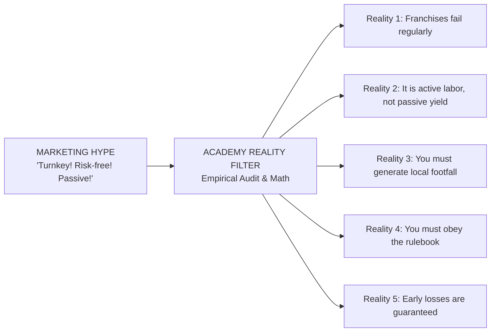

# Chapter 2: Debunking Franchise Myths — The Truth About Risk & "Passive Income"
## Volume 1: The First-Time Franchise Investor's Handbook

*Reading Time: 15 minutes*  
**Book Navigation:** [Previous: Chapter 1](chapter-01-what-is-franchising.md) | [Book 1 Overview](README.md) | **Next:** [Chapter 3: Choosing Your Operating Archetype](chapter-03-archetypes-and-models.md)  

---

## Learning Objectives
By the end of this chapter, you will be able to:
1. Deconstruct the five most common and dangerous myths in the Indian franchise industry.
2. Evaluate why "passive franchise ownership" is a deceptive promise in 95% of retail and service concepts.
3. Understand the division between National Brand Marketing and Local Store Marketing (LSM).
4. Identify how franchisor sales agents exploit the cognitive biases of first-time investors.

---

## 1. The Marketing Illusion vs. Commercial Reality

Franchise trade expos, investor webinars, and newspaper advertisements in India are filled with tantalizing headlines:
- *"Zero Experience Required — Complete Turnkey Setup!"*
- *"Assured 30% Annual Returns on Your Commercial Space!"*
- *"Be Your Own Boss and Earn While You Sleep!"*

For corporate managers weary of the 9-to-5 commute, or retirees seeking predictable cash flow, these promises sound irresistible. But in business, **abnormal returns without active effort or commensurate risk do not exist**.

Let us systematically dismantle the five most dangerous myths that trap first-time franchise buyers.

---

## 2. Myth 1: "Franchises Cannot Fail Because the System is Proven"

### The Myth
Sales representatives frequently cite outdated or fabricated statistics: *"Did you know 95% of franchises succeed, while 90% of independent businesses fail?"*

### The Reality
This claim is false. Academic research and regulatory disclosure audits in mature markets show that **franchise units fail, close, or transfer at rates between 20% and 35% within the first 3 to 5 years**.

A "proven system" merely means the business model worked in its initial flagship locations (often situated in high-footfall metropolitan hubs with low initial rents or founder-led supervision). It does **NOT** guarantee that the model will succeed when transplanted to a Tier-2 town, operated by inexperienced staff, facing localized competition, or saddled with high commercial rents.

A franchise system does not protect you against:
- Poor site selection with insufficient pedestrian density.
- Aggressive localized price-cutting by entrenched neighborhood competitors.
- Unreliable local employees who fail to show up, steal inventory, or mistreat customers.
- Changing macroeconomic conditions (inflation in food costs, GST rate hikes, or regulatory shifts).

---

## 3. Myth 2: "Franchising is a Source of Passive Income"

### The Myth
*"Invest ₹25 Lakhs, hire a store manager, and check your bank account every weekend to collect your profits."*

### The Reality
Unless you are investing in a verified corporate-operated flagship format (FOCO) backed by institutional balance sheets, **a FOFO franchise is an active operational job, not a passive financial instrument**.

In retail, hospitality, fitness, and services, the single greatest determinant of unit profitability is the **daily vigilance of the on-site owner**:
1. **Inventory Shrinkage & Pilferage:** In Indian retail and food outlets, employee theft, unbilled cash transactions, and raw material wastage can easily consume 4% to 8% of gross revenues if an owner is not physically supervising inventory audits.
2. **Staff Attrition:** Frontline service staff in India (waitstaff, retail associates, delivery executives) experience annual turnover rates exceeding 60% to 100%. An absentee franchise owner will constantly find their outlet shuttered or short-staffed unless they step in to hire, train, and occasionally work the floor themselves.
3. **Quality Degradation:** When the owner is absent, customer service standards decay, restrooms are neglected, food preparation hygiene slips, and Google reviews plummet.

> [!CAUTION]
> **Investor Warning:** If you cannot commit at least 20 to 30 hours per week to inspect operations, audit bank reconciliations, and manage staff—or if you do not have a trusted full-time operating partner—do **NOT** purchase a Franchise Owned, Franchise Operated (FOFO) unit. You will lose your capital to operational attrition.

---

## 4. Myth 3: "The Franchisor Does All the Marketing"

### The Myth
*"The brand runs national TV and digital ads, so customers will naturally line up at my door."*

### The Reality
Franchisors collect a **National Marketing Levy** (typically 1% to 3% of your Net Revenue). This pool of capital is legally allocated toward national brand awareness: celebrity endorsements, prime-time sports sponsorships, major search engine campaigns, and corporate PR.

However, national campaigns build brand awareness; they do **NOT** convert neighborhood customers:
- A national billboard campaign in Mumbai does not convince a family in Surat or Pune to visit your specific street corner.
- **Local Store Marketing (LSM)** is 100% your financial and operational responsibility: distributing pamphlets, conducting local school/office outreach, hosting local sampling events, negotiating tie-ups with nearby merchants, and running localized Instagram/Meta geofenced ads.

If you budget zero capital for local marketing, your outlet will remain an invisible island, regardless of how famous the master brand is.

---

## 5. Myth 4: "I Am My Own Boss"

### The Myth
*"I am an independent business owner. I make the decisions."*

### The Reality
As a franchisee, you are an **executive franchisee operator bound by contract**, not a sovereign founder:
- **Price Fixing:** In most franchise networks, you cannot raise or lower menu/product prices. If your local rent is unusually high, you cannot simply raise prices by 15% to compensate—the franchisor mandates uniform nationwide pricing.
- **Supplier Lock-In:** You must purchase raw materials, packaging, and uniform aprons exclusively from the franchisor or their mandated distributors, even if a local vendor offers identical goods at half the price.
- **Unannounced Inspections:** Franchisor auditors have the contractual right to enter your premises unannounced, inspect refrigerators, examine POS audit logs, and issue financial penalties or default notices for minor deviations.
- **Hours of Operation:** You are contractually obligated to remain open during mandated hours (e.g. 10:00 AM to 11:00 PM, 365 days a year), regardless of whether remaining open on Monday nights is profitable for your specific location.

---

## 6. Myth 5: "We Guarantee Break-Even in 3 Months and 30% ROI"

### The Myth
Franchise pitch decks frequently showcase uniform bar charts showing immediate profitability from month 2 and full capital payback by month 12.

### The Reality
Under Indian commercial law and platform ethical guidelines, **no legitimate business can guarantee future profits or break-even velocity**:
- Every customer acquisition curve follows the **J-Curve**: customer awareness builds slowly through word-of-mouth. Months 1 to 6 almost universally incur operational deficits where fixed costs (rent, staff salaries, electricity) exceed gross contribution margins.
- A franchisor offering a "guaranteed 30% return" is either engaging in deceptive sales practices or structuring an unregistered Collective Investment Scheme (CIS) that violates securities regulations.

---

## 7. Comparative Framework: Marketing Myth vs. Operational Reality

| Dimension | What the Sales Pitch Claims | What You Experience in Operations |
|---|---|---|
| **Daily Involvement** | "Passive investment; 2 hours a week." | 8 to 12 hours a day during months 1–6; constant weekend firefighting. |
| **Staffing** | "Trained staff provided by franchisor." | High employee turnover; you must constantly interview and train replacements. |
| **Marketing** | "Customers will flood in from Day 1." | Slow customer discovery; requires ₹15,000–₹30,000/month local marketing spend. |
| **Pricing** | "High gross margins of 65%." | Net margins after rent, electricity, waste, royalties, and taxes drop to 12%–18%. |
| **Dispute Rights** | "We treat you like family / our partner." | Strict legal contract where franchisor has unilateral power to issue breach notices. |
| **Flexibility** | "You have the freedom to innovate." | Zero menu/product changes permitted; strict adherence to SOP handbook enforced. |

---

## 8. Investor Warning: The "Assured Return" Ponzi Trap

In India, a recurring commercial scam involves companies advertising "Franchise Opportunities with Assured Monthly Rent / 24% Guaranteed Return."

**How the Scheme Operates:**
1. The promoter sells an unviable franchise concept (e.g. cloud kitchens, retail kiosks, or EV charging stations) for ₹15 Lakhs upfront.
2. The promoter promises to pay the investor ₹30,000 per month as "guaranteed return" for 36 months under a FOCO arrangement.
3. The promoter does not generate customer revenue. Instead, they use upfront joining fees collected from New Investor B to pay the monthly "returns" to Earlier Investor A.
4. When new franchise recruitment slows down after 12 to 18 months, the promoter defaults on monthly payouts, shuts down the corporate office, and absconds with the pooled capital.

> [!WARNING]
> **Cardinal Rule:** If a franchise offering promises a guaranteed, fixed monthly return on capital without operational risk, **it is not a franchise—it is a financial trap.** Legitimate franchising generates returns strictly from customer sales volume minus documented operating costs.

---

## 9. Key Takeaways

- Franchising significantly reduces startup setup friction, but it does **NOT** eliminate business failure risk.
- In 95% of retail and service concepts, an absent owner guarantees declining customer service, inventory pilferage, and commercial failure.
- National marketing builds global awareness; **Local Store Marketing (LSM)** is required to drive neighborhood footfall.
- You must be psychologically comfortable obeying another company’s rigid rulebook and paying ongoing royalties regardless of whether you make a net profit.
- Beware of any franchisor promising "guaranteed monthly returns"—legitimate franchise profits depend strictly on customer footfall and unit sales velocity.

---

## 10. Chapter 2 Knowledge Check

**Question 2.1:** Why is "passive ownership" dangerous in a Franchise Owned, Franchise Operated (FOFO) outlet?  
*(A)* Because the Indian Contract Act prohibits passive business investments.  
*(B)* Because high frontline staff turnover, inventory leakage, and decaying service standards rapidly erode margins without on-site owner supervision.  
*(C)* Because franchisors automatically revoke licenses if an owner is not physically present 24 hours a day.  
*(D)* Because passive businesses are taxed at higher statutory GST rates.  

**Question 2.2:** What is the primary difference between National Marketing Levies and Local Store Marketing (LSM)?  
*(A)* National levies fund central brand awareness (TV, celebrity, search); LSM is locally funded and executed by the franchisee to drive neighborhood footfall.  
*(B)* National levies are refundable if sales targets are missed; LSM is non-refundable.  
*(C)* National levies go directly into the franchisee’s personal bank account.  
*(D)* There is no difference; they are identical accounting lines.  

**Question 2.3:** An ad claims: *"Invest ₹20 Lakhs in our cloud kitchen franchise and receive a guaranteed ₹50,000 monthly payout for 3 years, risk-free!"* How should a prudent investor evaluate this?  
*(A)* Sign immediately to lock in the guaranteed 30% annualized yield.  
*(B)* Request a bank loan to invest multiple units.  
*(C)* Cease negotiations immediately; guaranteed return models are red flags for unsustainable Ponzi/capital-recycling structures.  
*(D)* Assume the franchisor has an insurance policy guaranteeing customer demand.  

---

### Answer Explanations
- **2.1: (B)** The reality of frontline Indian retail and hospitality operations is that inventory leakage and staff absenteeism will destroy unit economics unless actively managed by the local owner.
- **2.2: (A)** National brand marketing builds macro awareness, but customer footfall on your specific commercial street requires localized community outreach and targeted advertising.
- **2.3: (C)** Guaranteed return promises in operating businesses violate core commercial logic and often mask unauthorized collective investment schemes.

---

**Next:** [Chapter 3: Choosing Your Operating Archetype — FOFO, FOCO, COCO & Master Formats](chapter-03-archetypes-and-models.md)
