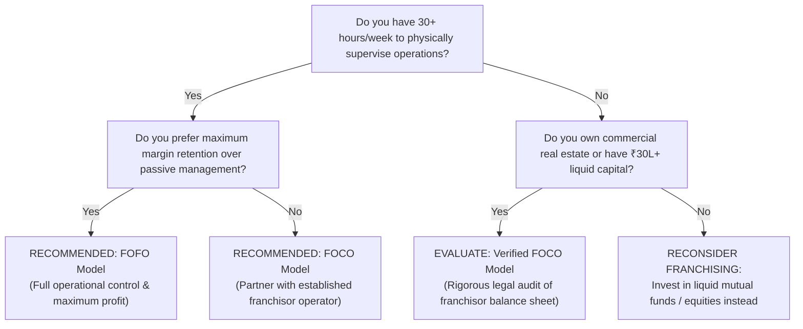

# Chapter 3: Choosing Your Operating Archetype — FOFO, FOCO, COCO & Master Formats
## Volume 1: The First-Time Franchise Investor's Handbook

*Reading Time: 16 minutes*  
**Book Navigation:** [Previous: Chapter 2](chapter-02-myths-vs-reality.md) | [Book 1 Overview](README.md) | **Next:** [Chapter 4: The Financial Anatomy of a Franchise](chapter-04-financial-mechanics.md)  

---

## Learning Objectives
By the end of this chapter, you will be able to:
1. Contrast the capital, operational, and margin profiles of the four primary franchise archetypes: FOFO, FOCO, COCO, and Master Franchising.
2. Read and apply a standardized Responsibility Assignment Matrix (RACI) across franchisor and franchisee duties.
3. Evaluate the structural trade-offs between higher margin retention with active labor (FOFO) vs. lower margin retention with passive management (FOCO).
4. Select the specific franchise model that strictly aligns with your personal capital, time availability, and risk tolerance.

---

## 1. The Archetype Spectrum: Balancing Capital and Labor

Before evaluating any specific brand, you must choose your **operating archetype**. In Indian franchising, one size does not fit all. The commercial market is divided into distinct models depending on **who provides the setup capital** and **who manages daily unit operations**.

```mermaid
quadrantChart
    title Franchise Archetype Matrix (Capital vs. Labor)
    x-axis Low Franchisee Operational Effort --> High Franchisee Operational Effort
    y-axis Low Franchisee Capital Required --> High Franchisee Capital Required
    quadrant-1 FOFO (Active Operator)
    quadrant-2 FOCO (Passive Capitalist)
    quadrant-3 Direct Distribution / Agency
    quadrant-4 COCO (Corporate Flagship)
    "FOFO Retail / F&B": [0.85, 0.75]
    "FOCO Hospitality / Apparel": [0.20, 0.85]
    "B2B Software Franchise": [0.75, 0.35]
    "Master Franchise": [0.65, 0.95]
```

---

## 2. Model 1: FOFO (Franchise Owned, Franchise Operated)

### The Core Structure
In a FOFO franchise:
- **Capital Provider:** The **Franchisee** funds 100% of the upfront CapEx (interior fit-out, machinery, lease security deposit) and maintains the working capital reserve.
- **Operator:** The **Franchisee** hires, manages, and pays frontline staff, manages daily customer sales, oversees inventory, and ensures store security.
- **Franchisor Role:** Provides trademark licensing, operational training, SOP manuals, central software/ERP, national marketing, and proprietary supply chain inputs.
- **Economic Mechanics:** The franchisee retains all net profits after paying fixed operating costs (rent, staff, electricity) and remitting an ongoing **Royalty Fee** (typically 4% to 10% of Net Revenue) or commission split to the franchisor.

### Advantages of FOFO
1. **Maximum Margin Retention:** Because you perform the active management work yourself, you retain 100% of the operational surplus after royalties.
2. **Operational Control:** You are on-site to minimize inventory leakage, manage customer relationships, and control operating overhead.
3. **Local Relationship Advantage:** In B2B and regional retail, local owner reputation drives customer trust and community word-of-mouth far better than a remote corporate manager.

### Disadvantages of FOFO
1. **Heavy Time Commitment:** Demands 50 to 70 hours per week during the first year. You cannot easily take extended vacations or treat it as a passive sideline.
2. **Operational Stress:** You are personally responsible for staff recruitment, employee attrition, local municipal clearances, and daily inventory audits.

**Best Suited For:** First-time entrepreneurs, owner-operators, family businesses, and professionals transitioning into full-time self-employment.

---

## 3. Model 2: FOCO (Franchise Owned, Company Operated)

### The Core Structure
In a FOCO franchise:
- **Capital Provider:** The **Franchisee** acts as an investor, purchasing or leasing the commercial premises and funding 100% of setup CapEx.
- **Operator:** The **Franchisor** assumes complete operational responsibility—hiring staff, managing store managers, maintaining inventory, and executing daily sales.
- **Economic Mechanics:** The franchisor and franchisee share gross or net operational profits based on a pre-agreed contractual ratio (commonly **50% Franchisee : 50% Franchisor**, or **40% Franchisee : 60% Franchisor**). Alternatively, some FOCO formats offer an assured minimum floor plus revenue share.

### Advantages of FOCO
1. **Semi-Passive Ownership:** The investor is not burdened by daily hiring, staff turnover, or customer service headaches.
2. **Professional Operational Standards:** Corporate-trained managers execute standardized brand protocols and visual merchandising.

### Disadvantages of FOCO
1. **Lower Profit Margins:** Because the franchisor bears management overhead, your net share of profits is substantially lower than in a FOFO model.
2. **Principal-Agent Conflict:** If the store struggles, corporate store managers may not treat your capital with the same urgency as an on-site owner would. If sales miss targets, your return on investment quickly collapses.
3. **Regulatory / Fraud Risk:** Unscrupulous operators disguise unsustainable Ponzi schemes as "FOCO with assured monthly returns."

**Best Suited For:** High-Net-Worth Individuals (HNIs), commercial landlords with vacant real estate, and passive investors seeking business cash flow without daily labor.

---

## 4. Model 3: COCO (Company Owned, Company Operated)

### The Core Structure
In a COCO format, the parent company owns 100% of the assets and operates the outlet directly through corporate employees. **No external investor or franchisee is involved.**

### Why COCO Matters to Franchise Investors
While you cannot purchase a COCO store, **inspecting a franchisor’s COCO units is the most critical step in your due diligence**:
- A franchisor that operates **zero COCO units** is asking you to take financial risks on a business model they have never proven with their own money.
- Healthy franchisors maintain a balanced network ratio (e.g., 20% COCO flagships and 80% FOFO franchise outlets).
- When you visit a franchisor's COCO flagship, you observe their **gold standard**: customer footfall, pricing realization, employee efficiency, and real-world gross margins.

---

## 5. Model 4: Master Franchise & Area Development

### The Core Structure
In a Master Franchise agreement:
- An ambitious investor acquires exclusive franchise development rights for a large geographic territory (e.g. the entire state of Gujarat, Maharashtra, or South India).
- The Master Franchisee opens flagship COCO units and recruits sub-franchisees within their territory.
- **Revenue Sharing:** The Master Franchisee collects joining fees and monthly royalties from sub-franchisees, sharing a predetermined percentage (e.g. 50:50) with the global/national franchisor.

**Capital Requirements:** Substantial (typically ₹1 Crore to ₹10 Crores+), requiring proven managerial experience and corporate infrastructure.

---

## 6. The Operational RACI Matrix: Demarcating Responsibilities

The table below illustrates the standard responsibility boundary across a Franchise Owned, Franchise Operated (FOFO) model:

*Legend: **R** = Responsible for execution; **A** = Accountable for outcome; **C** = Consulted; **I** = Informed.*

| Operational Activity | Franchisee Role | Franchisor Role | Practical Meaning |
|---|:---:|:---:|---|
| **Site Selection & Lease Execution** | **R / A** | **C** | Franchisee identifies location and signs lease; franchisor reviews traffic data. |
| **Upfront Store Build-out & CapEx** | **R / A** | **C** | Franchisee pays contractors; franchisor provides architectural blueprints. |
| **Trademark & Brand IP Ownership** | **I** | **R / A** | Franchisor owns trademarks; franchisee holds temporary operational license. |
| **Store Staff Hiring & Payroll** | **R / A** | **C** | Franchisee hires, manages, and pays monthly salaries for all local staff. |
| **Employee Training & Certification** | **R** | **A** | Franchisor provides curricula and exams; franchisee ensures staff attends. |
| **Central Product Supply & R&D** | **I** | **R / A** | Franchisor develops recipes/software; franchisee orders through central portal. |
| **Daily Sales & Cash Reconciliation** | **R / A** | **I** | Franchisee collects payments and deposits cash into commercial bank account. |
| **Local Store Marketing (LSM)** | **R / A** | **C** | Franchisee pays for local pamphlets/ads; franchisor provides approved creative. |
| **National Brand Advertising** | **I** | **R / A** | Franchisor executes national campaigns funded by marketing levies. |
| **Statutory GST & Local Trade Licenses** | **R / A** | **I** | Franchisee secures municipal FSSAI/Shop Act permits and files monthly returns. |
| **POS / ERP Maintenance & Uptime** | **I** | **R / A** | Franchisor hosts servers and fixes software bugs; franchisee reports issues. |
| **Unit Health Audits & Mystery Shopping** | **I** | **R / A** | Franchisor conducts unannounced inspections; franchisee must remediate defects. |

---

## 7. Decision Framework: Which Model Matches Your Reality?

Answer the following three questions to determine your ideal archetype:



---

## 8. Investor Warning: The "Hybrid FOCO" Trap

A deceptive structure emerging in the Indian market is the **"Unregulated Hybrid FOCO"**:
- The franchisor markets the unit as "FOCO" (they run the store), but the contract explicitly states that **the franchisee remains legally liable for employee wage disputes, local municipal fines, and vendor liabilities**.
- If the store underperforms, the franchisor quietly abandons the outlet, leaving the passive investor with unpaid store leases, angry employees demanding back-pay, and supplier lawsuits.

> [!CAUTION]
> **Contract Rule:** If a franchisor offers a FOCO agreement, the contract must explicitly state that the franchisor acts as an independent operational manager, indemnifying the investor against labor disputes, operational negligence, and regulatory penalties caused by corporate personnel.

---

## 9. Key Takeaways

- **FOFO** offers the highest profit retention but requires 50+ hours a week of hands-on owner vigilance.
- **FOCO** offers semi-passive convenience but yields significantly lower net margins and carries higher fraud risk.
- **COCO** units are the franchisor's benchmark; never invest in a brand that does not operate profitable company-owned flagship units.
- Review the **RACI matrix** carefully: you are responsible for hiring, payroll, local marketing, and local licenses in almost all Indian franchise models.

---

## 10. Chapter 3 Knowledge Check

**Question 3.1:** What is the primary operational difference between FOFO and FOCO?  
*(A)* In FOFO, the franchisor owns the physical real estate; in FOCO, the franchisee owns the real estate.  
*(B)* In FOFO, the franchisee manages daily unit operations and staff; in FOCO, the franchisor operates the store and shares profits.  
*(C)* FOFO is only used for food; FOCO is only used for software.  
*(D)* FOFO agreements do not require initial franchise fees.  

**Question 3.2:** Why should an investor be cautious when evaluating a franchisor that has ZERO company-owned (COCO) units?  
*(A)* Because the Indian Contract Act mandates a minimum of 5 COCO stores.  
*(B)* Because it indicates the franchisor has never risked their own capital to prove the unit economics of the model.  
*(C)* Because COCO units are required to file GST returns.  
*(D)* Because without COCO units, a franchisor cannot register a trademark.  

**Question 3.3:** Under a standard FOFO RACI matrix, who is responsible for funding and executing Local Store Marketing (LSM)?  
*(A)* The central franchisor marketing team exclusively.  
*(B)* The local municipality.  
*(C)* The local franchisee operator.  
*(D)* The landlord of the commercial building.  

---

### Answer Explanations
- **3.1: (B)** The acronyms define operational custody: FOFO = Franchisee Operated; FOCO = Company Operated.
- **3.2: (B)** A franchisor with zero skin in the game is using franchisee capital to experiment with an unproven business concept.
- **3.3: (C)** While franchisors run national brand campaigns, hyper-local marketing to neighborhood customers is the direct responsibility of the local franchisee.

---

**Next:** [Chapter 4: The Financial Anatomy of a Franchise — CapEx, Sunk Fees, Royalties & Working Capital](chapter-04-financial-mechanics.md)
