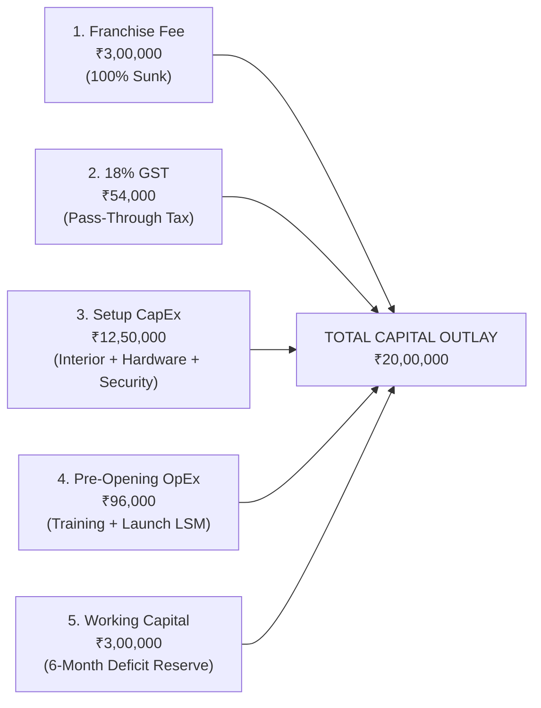

# Chapter 4: The Financial Anatomy of a Franchise — CapEx, Sunk Fees & Working Capital
## Volume 1: The First-Time Franchise Investor's Handbook

*Reading Time: 18 minutes*  
**Book Navigation:** [Previous: Chapter 3](chapter-03-archetypes-and-models.md) | [Book 1 Overview](README.md) | **Next:** [Chapter 5: Investor Self-Assessment](chapter-05-investor-self-assessment.md)  

---

## Learning Objectives
By the end of this chapter, you will be able to:
1. Calculate the true **Total Capital Outlay** of a franchise, deconstructing CapEx, sunk fees, taxes, and liquidity reserves.
2. Isolate statutory 18% Goods and Services Tax (GST) before computing revenue-sharing splits or royalties.
3. Compute the **Operational Break-Even Sales Volume** using fixed overheads and unit contribution margins.
4. Model a realistic 36-month unit cash flow statement and compute the **Simple Payback Period**.
5. Recognize why under-capitalizing working capital reserves is the #1 financial cause of franchise insolvency in India.

---

## 1. The Total Capital Equation

Many first-time franchise buyers make a fatal financial error: they look at the advertised "Franchise Fee: ₹5 Lakhs" and assume that having ₹6 Lakhs in their savings account makes them ready to launch.

In reality, the initial joining fee represents **only 10% to 20% of the true capital required to open and stabilize the business**.

The complete financial formula for any franchise investment is:

$$\text{Total Capital Outlay} = \text{Initial Franchise Fee} + \text{Statutory GST} + \text{Setup CapEx} + \text{Pre-Opening OpEx} + \text{Working Capital Cushion}$$



---

## 2. Deconstructing the 5 Capital Components

### Component 1: Initial Franchise Fee (100% Sunk Cost)
This is the one-time, non-refundable onboarding fee paid directly to the franchisor upon signing the agreement. It covers your legal license to use the trademark, initial corporate onboarding training, and software user credential provisioning. **Once paid, this money is gone forever.**

### Component 2: Statutory 18% GST on Services
Under Indian tax law, franchise licensing is classified as a supply of services subject to **18% Goods and Services Tax (GST)**:
- If the franchise fee is ₹3,00,000, you must remit **₹3,54,000** to the franchisor.
- If you have an active GST registration, you can claim the ₹54,000 as Input Tax Credit (ITC) to offset future output GST liability, but it must be funded in cash upfront.

### Component 3: Physical Setup CapEx (Capital Expenditures)
This represents the physical build-out of the store:
- **Interior Fit-Out:** Flooring, drywall partitions, ceiling lighting, electrical wiring, HVAC air conditioning, and branded wall graphics.
- **Machinery & IT Hardware:** Commercial kitchen equipment, POS terminals, thermal printers, barcode scanners, desktop computers, and CCTV security cameras.
- **Commercial Lease Deposit:** In Indian commercial centers, landlords demand 3 to 6 months of monthly rent as a refundable security deposit.

### Component 4: Pre-Opening Operating Expenses
Costs incurred before the first paying customer arrives:
- Travel, lodging, and meals during mandatory 5-day corporate training at franchisor headquarters.
- Staff recruitment agency fees and advance training wages.
- Launch marketing, local opening signage, flyers, and inaugural discount promotions.

### Component 5: The Working Capital Cushion (The Lifeboat)
**The most critical and most neglected component.** Even an exceptional franchise location rarely breaks even in Month 1. It takes 3 to 9 months for local customer awareness to build.

During these initial months, you must pay fixed monthly obligations—rent, staff salaries, electricity bills, and software subscriptions—regardless of whether customer revenue is zero.

> [!IMPORTANT]
> **Golden Rule of Working Capital:** You must maintain a liquid cash reserve equal to **at least 3 to 6 months of fixed monthly operating costs (OpEx)** sitting in your current account on Day 1. Never commit your last rupee to interior build-outs.

---

## 3. The 18% GST Pass-Through Segregation Rule

One of the most frequent sources of financial dispute in Indian franchising is the confusion between **Gross Billing** and **Net Realized Revenue**.

Under Platform Modeling Rule 3, statutory pass-through taxes must be isolated **before** computing royalties or commissions.

### The Correct Calculation Workflow
Suppose an educational or retail franchise sells a software package or merchandise bundle for a total MRP of **₹1,18,000 (tax inclusive)** under a **40% Franchisee : 60% Franchisor** revenue sharing agreement:

```text
STEP-BY-STEP REVENUE & TAX SETTLEMENT
---------------------------------------------------------------------------------------------------
Line Item                       Calculation Formula                      Amount (INR)
---------------------------------------------------------------------------------------------------
Gross Billing (Customer Paid)   MRP inclusive of 18% GST                  ₹1,18,000.00
Less: Statutory GST Liability   ₹1,18,000 / 1.18 * 0.18                  (₹18,000.00)  --> Remitted to Govt
---------------------------------------------------------------------------------------------------
Net Realized Revenue Pool       Gross Billing minus GST                   ₹1,00,000.00  --> Distributable Pool
---------------------------------------------------------------------------------------------------
Franchisee Share (40%)          ₹1,00,000.00 * 0.40                         ₹40,000.00  --> Franchisee Margin
Franchisor Share (60%)          ₹1,00,000.00 * 0.60                         ₹60,000.00  --> Royalty / Central
---------------------------------------------------------------------------------------------------
```

> [!CAUTION]
> **Contract Pitfall:** If a predatory agreement states that royalties are calculated on *"Total Gross Collections"*, the franchisor is extracting a percentage of the Government's GST money from your pocket! Always insist that the agreement specifies royalties apply strictly against **Net Realized Revenue (Net of GST and documented statutory pass-throughs)**.

---

## 4. The Core Mathematical Formulas for Franchise Investors

Every prospective investor must master four foundational equations:

### 1. Net Contribution Margin Per Unit ($NCM$)
The dollar amount each sale contributes toward covering fixed monthly overheads:
$$NCM = \text{Unit Selling Price (Net of GST)} - \text{Variable Unit Cost (COGS + Direct Delivery Fee)}$$

### 2. Operational Break-Even Sales Volume ($Q_{BE}$)
The minimum number of units you must sell each month to cover fixed rent, payroll, and utilities without losing money:
$$Q_{BE} = \frac{\text{Total Fixed Monthly Operating Overhead (OpEx)}}{NCM}$$

### 3. Return on Investment (Annualized ROI)
The percentage return on your initial capital:
$$\text{Annualized ROI} = \left( \frac{\text{Net Annual Cash Flow After All Expenses \& Taxes}}{\text{Total Initial Capital Outlay}} \right) \times 100$$

### 4. Simple Payback Period
The time required to fully recoup your initial cash out-of-pocket:
$$\text{Payback (Months)} = \frac{\text{Total Capital Outlay}}{\text{Average Net Monthly Cash Flow After Break-Even}}$$

---

## 5. Comprehensive Worked Case Study: "Apex Academy" Preschool & Learning Center

To see the math in action, let us model an Indian franchise opportunity:

### Scenario Parameters
- **Total Initial Capital Outlay:** ₹18,00,000 (Franchise fee ₹3L + GST ₹54k + Interiors ₹8.5L + Equip ₹2.5L + Lease Deposit ₹1.5L + Working Cap ₹2L).
- **Monthly Student Fee (Tuition):** ₹3,000 per student/month (Net of taxes).
- **Variable Cost per Student:** ₹500/month (Workbooks, activity kits, snacks).
- **Net Contribution Margin per Student ($NCM$):** ₹3,000 - ₹500 = **₹2,500/month**.
- **Franchisor Royalty Fee:** 10% of gross tuition = **₹300/student/month**.
- **Adjusted NCM to Franchisee:** ₹2,500 - ₹300 = **₹2,200/student/month**.

### Fixed Monthly Operating Expenses (OpEx)
- Commercial Premise Rent: ₹40,000
- 3 Teachers + 1 Caretaker Salaries: ₹45,000
- Electricity, Water & Air Conditioning: ₹12,000
- Local Marketing & Social Media: ₹8,000
- Central Software License / App Fee: ₹5,000
- **Total Fixed Monthly OpEx:** **₹1,10,000 per month**.

### Step 1: Calculate Operational Break-Even Student Count
$$Q_{BE} = \frac{\text{Fixed Monthly OpEx}}{\text{Adjusted NCM}} = \frac{₹1,10,000}{₹2,200} = \mathbf{50 \text{ Students}}$$

*Interpretation:* You must enroll and maintain **at least 50 paying students** every single month just to pay rent and salaries. Student #51 generates your first rupee of net profit!

---

### Step 2: 36-Month Pro-Forma Cash Flow Projections

Let us track the financial ramp-up across the 3-year investment horizon:

```text
36-MONTH UNIT ECONOMICS & CASH FLOW RAMP-UP
---------------------------------------------------------------------------------------------------
Financial Metric                Month 1–6 (Ramp)      Month 7–12 (Stabilized)  Year 2 (M13–24)   Year 3 (M25–36)
---------------------------------------------------------------------------------------------------
Active Paying Students          25 Students           55 Students              75 Students       90 Students
Gross Monthly Tuition (Net GST) ₹75,000.00            ₹1,65,000.00             ₹2,25,000.00      ₹2,70,000.00
Less: Variable Costs (₹500/ea)  (₹12,500.00)          (₹27,500.00)             (₹37,500.00)      (₹45,000.00)
Less: Royalty (10% Tuition)     (₹7,500.00)           (₹16,500.00)             (₹22,500.00)      (₹27,000.00)
---------------------------------------------------------------------------------------------------
Net Realized Contribution Pool  ₹55,000.00            ₹1,21,000.00             ₹1,65,000.00      ₹1,98,000.00
Less: Fixed Monthly OpEx        (₹1,10,000.00)        (₹1,10,000.00)           (₹1,15,000.00)*   (₹1,22,000.00)*
---------------------------------------------------------------------------------------------------
Net Monthly Cash Flow to Owner  (₹55,000.00) [LOSS]   ₹11,000.00 [PROFIT]      ₹50,000.00        ₹76,000.00
Cumulative Cash Deficit (Months 1–6): ₹3,30,000 (Funded by Working Capital Reserve)
---------------------------------------------------------------------------------------------------
*Includes 5% annual commercial rent escalation.
```

### Step 3: Compute Cumulative Payback
- **Upfront Outlay:** ₹18,00,000
- **Cumulative Early Deficit (Months 1–6):** -₹3,30,000
- **Net Operating Surplus in Months 7–12:** ₹11,000 $\times$ 6 = ₹66,000
- **Net Operating Surplus in Year 2:** ₹50,000 $\times$ 12 = ₹6,00,000
- **Net Operating Surplus in Year 3:** ₹76,000 $\times$ 12 = ₹9,12,000
- **Total Cash Recouped by End of Year 3:** ₹66,000 + ₹6,00,000 + ₹9,12,000 = **₹15,78,000**.
- **Full Capital Payback:** Occurs at approximately **Month 39** (3.25 years).

---

## 6. Investor Warning: The "Zero-Velocity" Drawdown Test

Before investing, stress-test your business against a **Zero-Velocity Drawdown**:
- What if opening delays (e.g. municipal signage permits, delayed contractor fit-out) prevent you from opening for 60 days?
- What if enrollment builds at only half the projected pace?

If your fixed monthly overhead is ₹1,10,000 and you experience 3 months of delay plus 6 months of sub-break-even enrollment, you will burn **₹4,50,000 to ₹6,00,000 in cash reserves** before the business stabilizes. If you did not budget this working capital cushion on Day 1, you will be forced to shut down a viable business simply because you ran out of cash.

---

## 7. Key Takeaways

- Total Capital Outlay = Franchise Fee + GST + Fit-out CapEx + Lease Deposit + **3–6 Months Working Capital Cushion**.
- In India, 18% GST must be isolated first; royalties must strictly apply against Net Realized Revenue.
- Break-Even Units = Fixed Monthly OpEx divided by Net Contribution Margin per unit.
- Real-world franchise payback in India typically takes **24 to 36 months**; any sales pitch claiming full payback in 6 months is almost certainly hiding realistic operating expenses.
- Lack of adequate working capital is the single greatest cause of early-stage franchise insolvency.

---

## 8. Chapter 4 Knowledge Check

**Question 4.1:** A retail franchise sells goods for ₹1,18,000 tax-inclusive (18% GST). If the agreement mandates an 8% royalty on Net Revenue, what is the exact royalty fee owed to the franchisor?  
*(A)* ₹9,440 (8% of ₹1,18,000)  
*(B)* ₹8,000 (8% of ₹1,00,000 Net Revenue)  
*(C)* ₹18,000  
*(D)* ₹1,440  

**Question 4.2:** If a franchise has fixed monthly expenses of ₹1,50,000 and earns a net contribution margin of ₹500 per customer transaction, how many customer transactions are required each month to achieve operational break-even?  
*(A)* 150 transactions  
*(B)* 300 transactions  
*(C)* 500 transactions  
*(D)* 1,500 transactions  

**Question 4.3:** Why is working capital cushion essential even if a franchise has a prestigious national brand name?  
*(A)* Because the franchisor charges a penalty if current account balances fall below zero.  
*(B)* Because local customer adoption follows a J-curve, requiring 3 to 9 months of cash reserves to fund fixed monthly rent and payroll before reaching break-even.  
*(C)* Because statutory income tax must be paid 12 months in advance.  
*(D)* It is not essential; national brands guarantee immediate day-one profits.  

---

### Answer Explanations
- **4.1: (B)** Statutory 18% GST (₹18,000) is deducted first: ₹1,18,000 / 1.18 = ₹1,00,000 Net Revenue. The 8% royalty on ₹1,00,000 is exactly ₹8,000.
- **4.2: (B)** Break-even units = ₹1,50,000 / ₹500 = 300 transactions.
- **4.3: (B)** Initial ramp-up periods incur operational losses; without working capital reserves, the unit fails before reaching its break-even enrollment/sales targets.

---

**Next:** [Chapter 5: Investor Self-Assessment — Capital, Skills & Risk Tolerance](chapter-05-investor-self-assessment.md)
