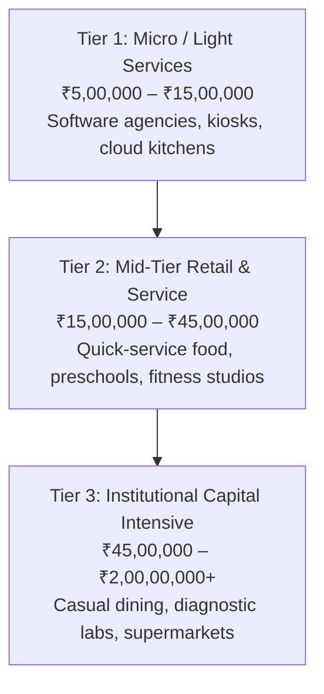

# Chapter 5: Investor Self-Assessment — Capital, Skills & Risk Tolerance
## Volume 1: The First-Time Franchise Investor's Handbook

*Reading Time: 13 minutes*  
**Book Navigation:** [Previous: Chapter 4](chapter-04-financial-mechanics.md) | [Book 1 Overview](README.md) | **Next:** [Chapter 6: Spotting Red Flags & Initiating Due Diligence](chapter-06-red-flags-and-due-diligence.md)  

---

## Learning Objectives
By the end of this chapter, you will be able to:
1. Map your available liquid net worth to the three distinct investment tiers in the Indian franchise market.
2. Differentiate between your profile as an **Active Operator**, an **Executive Manager**, or a **Passive Financier**.
3. Complete the 10-Question Franchise Readiness Diagnostic to evaluate your commercial suitability.
4. Assess your psychological tolerance for operating within a rigid, franchisor-controlled corporate framework.

---

## 1. The Mirror Test: Why Great Investors Fail in Franchising

Before analyzing brand prospectuses, visiting corporate discovery days, or negotiating with landlords, you must conduct a rigorous internal audit.

The most tragic failures in Indian franchising occur not because the brand was flawed, but because **the investor selected a model that clashed with their personal capital, operational skills, or temperament**:
- A brilliant software engineer who hates sales purchases an agency franchise that requires knocking on 20 business doors every day.
- A senior corporate vice-president accustomed to personal assistants buys a café franchise and is shocked to discover they must clean espresso machines and manage teenage baristas.
- A conservative family invests 100% of their life savings into a trendy food concept with zero working capital reserve.

Let us evaluate the three core dimensions of franchise readiness: **Capital**, **Role**, and **Temperament**.

---

## 2. Dimension 1: The Three Capital Tiers in India

In India, franchise opportunities naturally cluster into three primary capital investment bands:



### Tier 1: Micro & Service Franchises (₹5 Lakhs – ₹15 Lakhs)
- **Typical Verticals:** B2B software distribution, logistics booking kiosks, cloud kitchens, test-prep coaching centers, water purification kiosks.
- **Premises Required:** Zero real estate (home-based) or small commercial offices (150 – 400 sq. ft.).
- **Staffing:** 1 to 3 employees, or owner-operated.
- **Risk Profile:** Low capital loss risk, but relies 100% on the owner’s personal daily sales hustle.

### Tier 2: Mid-Tier Retail & Consumer Services (₹15 Lakhs – ₹45 Lakhs)
- **Typical Verticals:** Quick-Service Restaurants (QSR cafés, pizza, ice cream), preschools, salon & spa franchises, optical retail stores, pathology collection centers.
- **Premises Required:** High-street retail or commercial mall space (400 – 1,200 sq. ft.).
- **Staffing:** 4 to 8 frontline employees.
- **Risk Profile:** Moderate to high; heavily dependent on pedestrian footfall, local commercial rent negotiation, and rigorous inventory shrinkage control.

### Tier 3: Large Capital-Intensive Franchises (₹45 Lakhs – ₹2 Crores+)
- **Typical Verticals:** Full-service casual dining restaurants, supermarkets, diagnostic imaging centers (MRI/CT scan), international fitness centers, boutique hotels.
- **Premises Required:** Major standalone commercial properties (2,000 – 10,000+ sq. ft.).
- **Staffing:** 15 to 40+ specialized staff with departmental managers.
- **Risk Profile:** High capital intensity requiring institutional syndication, commercial bank debt, and professional corporate governance.

---

## 3. Dimension 2: The Three Franchisee Personas

Which of the following three personas reflects how you will spend your Monday mornings?

| Persona Profile | Weekly Time Commitment | Primary Daily Activities | Best Matched Archetype |
|---|---|---|---|
| **1. The Hands-On Operator** | 50 – 70 Hours / Week | On-site daily; managing staff, serving customers, counting inventory, running cash registers. | **FOFO (Retail, Food, Salons)** |
| **2. The Executive Manager** | 15 – 25 Hours / Week | Employs an on-site store manager; focuses on hiring, weekly P&L reviews, local marketing, and business development. | **FOFO (Multi-Unit, B2B Software)** |
| **3. The Passive Financier** | 2 – 5 Hours / Week | Provides capital and commercial lease; relies on corporate operations team to run the unit; reviews monthly reports. | **FOCO (Flagship Retail, Hotels)** |

> [!CAUTION]
> **The Classic Trap:** Purchasing a **FOFO café or restaurant** while planning to remain a **Passive Financier**. Unless you have a trusted family member or co-owner on-site every day, your investment will disintegrate due to employee turnover, unrecorded cash sales, and poor customer service.

---

## 4. Dimension 3: The Temperament & System-Adherence Test

Franchising is fundamentally an exercise in **conformity**. 

If you possess a fiercely independent, rebellious entrepreneurial mindset—someone who constantly says: *"I have a better way to do this," "Why should I use their supplier when my cousin can sell it to me cheaper?", "I want to change the logo colors"*—**you will be miserable in a franchise system**.

A successful franchise partner possesses the mindset of an **elite airline pilot**:
- You did not design the Boeing 777 aircraft.
- You did not write the pre-flight checklist.
- But you execute the checklist with absolute discipline, precision, and consistency every single day to ensure a safe, profitable flight.

---

## 5. The 10-Question Franchise Readiness Diagnostic

Score yourself on the following 10 statements (Award points: **10 = Strongly Agree**, **5 = Neutral**, **0 = Strongly Disagree**):

```text
FRANCHISE INVESTOR READINESS DIAGNOSTIC
---------------------------------------------------------------------------------------------------
#   Readiness Statement                                                         Score (0 / 5 / 10)
---------------------------------------------------------------------------------------------------
01. I have at least 6 months of living expenses set aside in liquid funds,     [  ] Points
    completely separate from the capital I am investing in this franchise.
02. I have budgeted an additional 25% beyond the franchisor's CapEx estimate   [  ] Points
    to fund early operating deficits and delayed break-even periods.
03. I am comfortable spending 40+ hours a week working inside the store         [  ] Points
    during the first 6 to 12 months of operations.
04. I am willing to follow the franchisor's operating manual 100%, without     [  ] Points
    demanding unilateral changes to products, menus, or pricing.
05. I have prior experience managing frontline staff, conducting interviews,   [  ] Points
    and resolving employee interpersonal conflicts.
06. I have reviewed the commercial failure rates in this industry and accept    [  ] Points
    that this investment carries genuine commercial risk of capital loss.
07. I have the full, enthusiastic backing of my immediate family/spouse        [  ] Points
    for the weekend hours and operational stress required.
08. I am comfortable with active customer service, resolving complaints,       [  ] Points
    and physically inspecting store cleanliness.
09. I understand how to read a monthly P&L statement, balance sheet,           [  ] Points
    and understand the difference between gross revenue and net cash flow.
10. I am not borrowing more than 50% of the total project cost through debt,   [  ] Points
    and I am NOT mortgaging my primary residential home.
---------------------------------------------------------------------------------------------------
TOTAL READINESS SCORE (OUT OF 100):                                            [  ] / 100
---------------------------------------------------------------------------------------------------
```

### Interpreting Your Score
- **80 – 100 Points (High Readiness):** You possess the financial reserves, realistic operational expectations, and disciplined temperament to be a top-performing franchise operator.
- **50 – 75 Points (Moderate Readiness):** Significant gaps exist. You likely need a full-time operating partner to complement your profile or require a larger working capital cushion before proceeding.
- **Below 50 Points (Low Readiness):** **Do not invest in a franchise today.** You risk severe financial stress and operational burnout. Keep your capital in secure, liquid savings until your personal readiness improves.

---

## 6. Investor Warning: The Over-Leverage Trap

A frequent mistake in India is funding a franchise almost entirely through high-interest personal loans, gold loans, or borrowing against ancestral land:
- If a franchise project costs ₹25 Lakhs, and you borrow ₹20 Lakhs at 14% interest, your monthly debt servicing (EMI) will be approximately **₹46,000 per month**.
- In Months 1 to 6, when the business is already generating an operational cash deficit of ₹30,000 to ₹50,000 per month, adding a ₹46,000 debt EMI creates an impossible monthly cash drain of **₹80,000 to ₹1,00,000**.
- Within 120 days, the investor defaults on their loan, credit ratings are destroyed, and the bank initiates recovery proceedings.

> [!WARNING]
> **Prudent Debt Ceiling:** Never borrow more than **40% to 50% of the total project cost** to fund a franchise. Ensure your equity contribution covers all upfront CapEx and franchise fees, using bank loans strictly for machinery/hardware that can be collateralized.

---

## 7. Key Takeaways

- Match your capital to the appropriate tier: Micro (₹5L–₹15L), Mid-Tier (₹15L–₹45L), or Institutional (₹45L+).
- Be honest about your role: If you cannot give 50 hours a week, do not purchase a FOFO retail or food franchise without an active operating partner.
- Franchising demands disciplined system-followers, not rebellious experimenters.
- Never borrow 100% of the project capital or risk your primary residence—debt EMIs during the initial ramp-up phase will crush early cash flow.

---

## 8. Chapter 5 Knowledge Check

**Question 5.1:** If an investor has ₹12 Lakhs total liquid savings, which franchise tier is financially realistic?  
*(A)* Tier 3: Casual dining restaurant requiring ₹60 Lakhs CapEx.  
*(B)* Tier 1: Micro / light services franchise requiring ₹6L–₹8L CapEx, leaving ₹4L as working capital cushion.  
*(C)* Borrowing ₹50 Lakhs on personal credit cards to open a flagship supermarket.  
*(D)* Signing a FOCO hotel lease.  

**Question 5.2:** Which personality trait is most positively correlated with success as a franchisee?  
*(A)* Constantly disregarding standard rules and altering product designs without approval.  
*(B)* Disciplined execution of codified checklists and standard operating procedures.  
*(C)* Total delegation of all operations without inspecting financial reports.  
*(D)* Refusing to communicate with corporate headquarters.  

**Question 5.3:** What is the maximum prudent debt financing percentage recommended for a franchise setup?  
*(A)* 100% debt financing.  
*(B)* Not more than 40% to 50% of the total capital required, ensuring debt EMIs do not overwhelm early operating deficits.  
*(C)* Borrowing against emergency family health insurance funds.  
*(D)* 90% debt with zero equity contribution.  

---

### Answer Explanations
- **5.1: (B)** An investor with ₹12L liquid savings should target a ₹6L–₹8L concept to preserve a mandatory ₹4L working capital reserve for early operating losses.
- **5.2: (B)** Franchising rewards consistent, high-fidelity execution of proven operational procedures.
- **5.3: (B)** Excessive leverage creates crushing monthly debt service obligations that trigger bankruptcy before break-even is achieved.

---

**Next:** [Chapter 6: Spotting Red Flags & Initiating Due Diligence](chapter-06-red-flags-and-due-diligence.md)
