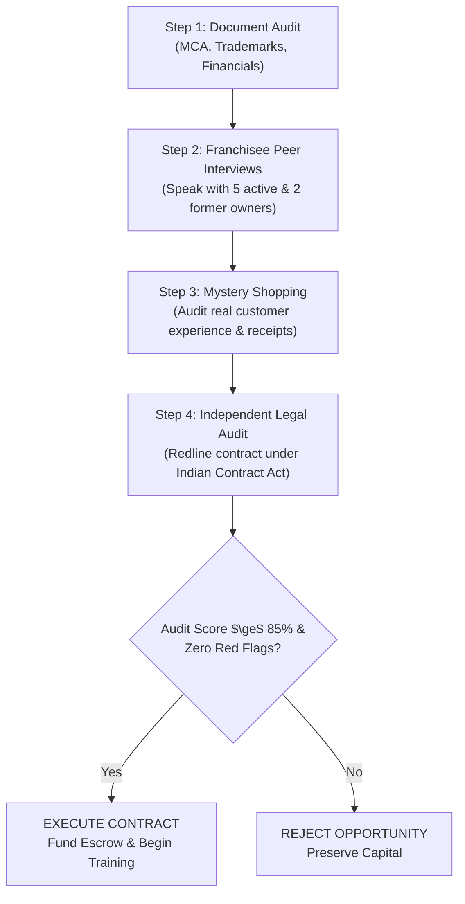

# Chapter 6: Spotting Red Flags & Initiating Due Diligence
## Volume 1: The First-Time Franchise Investor's Handbook

*Reading Time: 17 minutes*  
**Book Navigation:** [Previous: Chapter 5](chapter-05-investor-self-assessment.md) | [Book 1 Overview](README.md) | **Next:** [Knowledge Checks & Case Studies](quizzes-and-case-studies.md)  

---

## Learning Objectives
By the end of this chapter, you will be able to:
1. Identify the 10 fatal red flags that signal a predatory, fraudulent, or economically unviable franchise offering.
2. Execute the 4-phase investor due diligence protocol from initial brochure review to legal contract execution.
3. Conduct structured investigative interviews with existing and former franchisees without corporate supervision.
4. Contrast the transparent behaviors of an ethical franchisor against the high-pressure tactics of an aggressive franchise broker.

---

## 1. Introduction: Trust, But Verify

In business consulting, there is an enduring adage: *"The most expensive franchise you will ever buy is the one with the cheapest joining fee and the most enthusiastic sales broker."*

Franchise recruitment in India is a multi-crore sales industry. Franchise marketing executives and third-party brokerage agencies earn lucrative commissions (often 20% to 40% of the upfront joining fee) for every contract they close. Consequently, their primary incentive is to close your deal quickly—**not to ensure your long-term unit survival**.

To protect your capital, you must transform from an impressionable sales prospect into an **objective forensic investigator**.

---

## 2. The 10 Fatal Red Flags in Indian Franchising

If you encounter ANY of the following 10 warning signs during your evaluation, **immediately halt negotiations**:

### Red Flag 1: The "Guaranteed Return" or "Assured Buyback" Promise
- **The Pitch:** *"We guarantee an assured monthly rental/return of 25% on your capital!"*
- **The Reality:** Real business profits are variable and depend on market demand. Guaranteed returns in operating retail or food businesses are almost universally Ponzi schemes, where earlier investors are paid with joining fees collected from newer recruits.

### Red Flag 2: Extreme High-Pressure Sales Tactics
- **The Pitch:** *"You must sign today and transfer a ₹50,000 token deposit, or we will give this prime taluka/territory to another buyer tomorrow!"*
- **The Reality:** Reputable, institutional franchisors want thoroughly vetted, well-capitalized partners who complete full due diligence. Only desperate or predatory operators demand unrefundable deposits before sharing contracts.

### Red Flag 3: Refusal to Provide an Unfiltered Franchisee Directory
- **The Pitch:** *"We cannot share other franchisees' phone numbers due to privacy laws, but we can arrange a call with our top-performing partner in Mumbai."*
- **The Reality:** The franchisor is cherry-picking their single best-performing outlet (often a company-subsidized unit) to deceive you. An ethical franchisor provides a full list of all active and former franchisees across India.

### Red Flag 4: Unregistered, Opposed, or Third-Party Trademarks
- **The Pitch:** *"The trademark is under process, don't worry, it's 100% ours."*
- **The Reality:** You inspect the Indian Intellectual Property Office portal (`ipindia.gov.in`) and discover the trademark is "Objected," "Abandoned," or registered under an unrelated third party's name. If you sign, you risk receiving an immediate trademark infringement cease-and-desist notice and court injunction forcing you to close your store.

### Red Flag 5: Lack of Audited Corporate Financials
- **The Pitch:** *"We are an early-stage startup, so our formal balance sheets aren't ready yet."*
- **The Reality:** If a franchisor cannot provide 3 years of audited P&L statements and balance sheets verified on the Ministry of Corporate Affairs (MCA) portal, you have zero evidence that the parent corporation is solvent.

### Red Flag 6: Zero Profitable Company-Owned (COCO) Units
- **The Pitch:** *"We are purely an asset-light franchise expansion platform."*
- **The Reality:** "Asset-light" often means the founders have never risked their own money operating a store, or their own attempts at running stores failed. If they cannot make the concept profitable with their own capital, why should you be able to?

### Red Flag 7: Predatory Supply Chain Markups
- **The Pitch:** *"You must buy all proprietary sauces, pizza dough, or uniforms exclusively from our central warehouse."*
- **The Reality:** The franchisor prices basic, unbranded commodities at 200% to 400% of market rates. They use captive supply pricing to extract all the operational profit from your store, leaving you with zero net margin.

### Red Flag 8: Cash-Only Joining Fees (Tax Evasion)
- **The Pitch:** *"Pay ₹2 Lakhs by cheque with GST, and pay ₹3 Lakhs in cash off-the-record to save tax."*
- **The Reality:** Any franchisor asking for unbilled cash transactions is engaged in criminal tax evasion. You lose all legal recourse if the franchisor defaults, and you expose yourself to severe penalties from tax enforcement authorities.

### Red Flag 9: Asymmetric, One-Way Contract Terms
- **The Pitch:** *"This is our standard boilerplate agreement; nobody ever changes it."*
- **The Reality:** The agreement allows the franchisor to terminate your contract on 24 hours notice for minor technicalities, but denies you any right to exit if the franchisor fails to deliver promised support, software, or supply chains.

### Red Flag 10: Chronic Litigation & Network Churn
- **The Pitch:** *"A few disgruntled partners tried to copy our business, so we had to sue them."*
- **The Reality:** A quick search on the Indian e-Courts portal reveals dozens of commercial lawsuits filed by franchisees alleging fraud, breach of territory, or non-delivery of equipment. High network churn (> 20% of units closing annually) indicates systemic model failure.

---

## 3. The 4-Phase Investor Due Diligence Protocol

Follow this structured 4-phase audit before committing capital:

### Phase 1: Corporate & Regulatory Forensic Audit (Online)
1. **MCA Company Search:** Verify entity status on `mca.gov.in`. Check authorized capital, paid-up capital, date of incorporation, active charges/mortgages on assets, and Director Identification Numbers (DIN).
2. **IP India Trademark Search:** Visit `ipindia.gov.in`. Confirm the brand trademark is **Registered** (Status: *Registered*, not *Objected* or *Refused*) under the exact corporate entity name in the appropriate classes (Class 9 for software, Class 43 for food/restaurants, Class 35 for retail services).
3. **Litigation Search:** Check district court and high court e-filing registries for pending criminal cases (Section 420 IPC / Cheating) or commercial arbitrations involving the directors.

### Phase 2: Franchisee Peer Interviews (The Acid Test)
Obtain the complete network directory and independently contact at least **5 active franchisees** and **2 former franchisees** in different cities. Conduct these interviews privately without franchisor representatives present.

**The 5 Essential Questions to Ask Existing Franchisees:**
1. *"Did your actual setup CapEx match the franchisor’s original budget, or were there major unexpected cost blowouts?"*
2. *"How many months did it take you to reach operational break-even (where monthly revenue covered rent and salaries)?"*
3. *"Does the franchisor provide timely central support, or do software/supply issues take weeks to resolve?"*
4. *"What percentage of your sales goes toward Local Store Marketing (LSM) to keep footfall alive?"*
5. *"Knowing everything you know today, would you sign this franchise agreement again?"*

### Phase 3: Mystery Shopping & Ground Reality Check
Spend 3 days inspecting existing franchise units during peak and off-peak hours:
- Sit in a store on a Tuesday afternoon and a Saturday evening. Count the number of paying customers.
- Purchase products as a regular customer. Check product quality, packaging, billing accuracy, and staff cleanliness.
- Examine customer Google reviews: Are recurring complaints focused on rude staff, bad taste, or chronic out-of-stock items?

### Phase 4: Independent Legal & Financial Contract Redlining
Never sign the agreement presented to you without professional redlining:
- Retain an independent commercial corporate lawyer (not a real estate broker or family friend).
- Review non-compete covenants, territory definitions, dispute resolution clauses, and termination terms.
- Use our [100-Point Franchise Due Diligence Checklist](../DUE_DILIGENCE_CHECKLIST.md) to formally score the opportunity.

---

## 4. Ethical Franchisor vs. Predatory Franchisor Comparison

| Attribute | Ethical, Institutional Franchisor | Predatory / High-Risk Operator |
|---|---|---|
| **Sales Approach** | Consultative; screens prospects thoroughly; willing to reject undercapitalized buyers. | Aggressive; high-pressure deadlines; accepts anyone with available cash. |
| **Financial Disclosures** | Provides realistic conservative P&L models; highlights operating risks and failure factors. | Promises "guaranteed returns," "rapid payback," and ignores working capital deficits. |
| **Franchisee Access** | Shares complete, unfiltered contact list of all current and former franchise owners. | Refuses access or arranges supervised calls with a single handpicked favorite. |
| **Supply Chain Pricing** | Transparent pricing; fair market rates; volume discounts passed to franchisees. | Hidden markups; charges 200%+ market rates for basic consumables. |
| **Contract Balance** | Mutual termination rights; cure periods for defaults; reasonable non-compete clauses. | Unilateral franchisor termination power; zero franchisee exit rights; draconian penalties. |
| **Company Units** | Operates successful, profitable company-owned flagship locations (COCO). | Operates zero company units; 100% of commercial risk shifted to external investors. |

---

## 5. Key Takeaways

- Beware of high-pressure sales brokers: true institutional franchisors conduct mutual due diligence and never rush contracts.
- Independent franchisee peer interviews are the single most reliable predictor of future operational reality.
- Always verify corporate registration on MCA and trademark status on the IP India portal.
- Redline the franchise contract with an independent corporate lawyer before paying joining fees or signing leases.
- Use the [100-Point Franchise Due Diligence Checklist](../DUE_DILIGENCE_CHECKLIST.md)—if the brand scores below 75 points or triggers any fatal red flags, walk away.

---

## 6. Chapter 6 Knowledge Check

**Question 6.1:** What is the primary purpose of conducting independent peer interviews with existing franchisees?  
*(A)* To ask them for commercial loans to fund your franchise fee.  
*(B)* To verify whether actual CapEx, break-even timelines, and support reality match the franchisor's sales pitch.  
*(C)* To negotiate lower prices on used kitchen equipment.  
*(D)* To invite them to join a competitor's network.  

**Question 6.2:** If the Indian IP Office portal shows a franchisor's trademark status as "Refused" or "Objected," what is the primary risk to the franchisee?  
*(A)* The franchisee cannot obtain a bank loan.  
*(B)* The franchisee risks receiving third-party trademark infringement lawsuits, court injunctions, and being forced to de-brand and shut down their store.  
*(C)* The franchisor must double their franchise fees.  
*(D)* There is no legal risk as long as the contract is notarized.  

**Question 6.3:** A franchise broker states: *"You must wire a ₹1 Lakh token deposit before 5:00 PM today to reserve this territory, otherwise we are awarding it to another buyer."* What should the investor do?  
*(A)* Wire the funds immediately using digital UPI to lock in the territory.  
*(B)* Recognize the high-pressure sales tactic designed to bypass due diligence; refuse to transfer funds until full audit and contract review are complete.  
*(C)* Offer to pay ₹2 Lakhs instead to ensure exclusivity.  
*(D)* Sign a blank promissory note.  

---

### Answer Explanations
- **6.1: (B)** Existing operators have no incentive to lie to a fellow prospect; their real-world experience reveals the true operational and financial health of the brand.
- **6.2: (B)** Licensing an unprotectable or infringing trademark exposes the local operator to legal injunctions and immediate loss of their retail investment.
- **6.3: (B)** Artificial urgency is a classic sales manipulation tactic used to pressure buyers into skipping forensic audits and contract redlining.

---

**Next:** [Knowledge Checks, Quizzes & Detailed Educational Case Studies](quizzes-and-case-studies.md)
