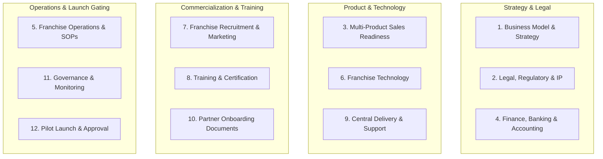

# Franchise Launch Readiness Framework: 12-Workstream Operational Standard

## 1. Purpose
The **Franchise Launch Readiness Framework** establishes a standardized, client-independent, and auditable methodology for evaluating whether an enterprise is commercially, legally, technologically, and operationally prepared to launch and scale a franchise network. 

Premature franchise recruitment without verified operational delivery, legal gating, and unit economic validation represents the single largest cause of franchise system failure and investor litigation. This framework decomposes franchise launch readiness into **12 exhaustive workstreams**, enforces **6 sequential launch gates**, and codifies **critical launch blockers** to ensure zero premature market commitments.

---

## 2. Business Questions Addressed
1. What operational, legal, financial, and technological criteria must be verified before signing the first commercial franchisee?
2. How can a franchisor de-risk expansion across multiple product lines and decentralized territories?
3. What distinction must be maintained between draft documentation, reviewed policies, approved contracts, implemented systems, and verified field operations?
4. How are responsibilities demarcated across business analysts, software engineers, legal counsel, chartered accountants, operations leads, and executive leadership?
5. Which catastrophic defects constitute absolute launch blockers that prevent franchise rollout regardless of overall percentage completion?

---

## 3. Required Inputs
To initiate a launch readiness assessment for any enterprise, the following artifacts must be provided:
- **Commercial Strategy:** Franchise archetype specification (FOFO, FOCO, COCO, Master Franchise), target territory demographics, joining fee structures, and revenue sharing rules.
- **Product Portfolio:** Detailed product/service catalog, licensing tiers, unit prices, implementation fee schedules, and demonstration environments.
- **Financial Baseline:** Decimal-safe unit economics model, CapEx outlays, monthly fixed OpEx budgets, working capital reserves, and 36-month P&L forecasts.
- **Legal & Governance Drafts:** Master franchise agreements, IP/trademark licenses, non-disclosure agreements, territory boundaries, and regulatory compliance records.
- **Operational SOPs:** Unit launch guides, sales scripts, client onboarding protocols, support SLA escalations, and training curricula.
- **Technology Infrastructure:** Central partner portal specifications, CRM deal registration locks, billing integration, and cloud provisioning systems.

---

## 4. Methodology & Theoretical Foundations

### The 12 Canonical Workstreams
The framework organizes readiness activities into 12 structured functional domains:

1. **Business Model & Commercial Strategy:** Archetype alignment, territory allocation, pricing tiers, commission splits, unit economics, and 3-year rollout strategy.
2. **Legal, Regulatory & Intellectual Property:** Master agreements, IP licenses, non-compete covenants, disclosure compliance (Item 19), termination/renewal terms, and statutory tax structuring.
3. **Multi-Product Sales Readiness:** Product demo instances, value proposition briefs, battlecards, prospect evaluation sheets, and deal registration mechanisms.
4. **Finance, Banking & Accounting:** Dedicated franchisor accounts, automated pass-through tax segregation (e.g., GST), TDS reconciliation, working capital verification, and chartered accountant model sign-off.
5. **Franchise Operations & SOPs:** Unit launch checklists, daily operational cadence, customer onboarding SOPs, support SLAs, and annual audit inspection handbooks.
6. **Franchise Management Technology:** Partner portal, CRM deal locking, billing engine, automated license provisioning, SSO/RBAC, and telemetry dashboards.
7. **Franchise Recruitment & Marketing:** Value propositions, investor pitch decks, brochures, prospectuses, qualification rubrics, discovery day protocols, and lead funnels.
8. **Training & Certification:** 10-day onboarding curriculum, product mastery courses, customer service workshops, exam assessments, and formal certification issuance.
9. **Central Delivery & Customer Support:** Central deployment engineering, cloud hosting uptime (99.9%), Tier-2/3 escalation protocols, disaster recovery, and bug patching cycles.
10. **Partner Onboarding Documents:** Due diligence questionnaires, KYC/background checks, liquid capital verification, LOI forms, welcome kits, and office audit sign-offs.
11. **Governance & Performance Monitoring:** 13 core KPIs, minimum sales benchmarks (quotas), territory dispute mediation, Franchise Advisory Councils (FAC), and penalty frameworks.
12. **Pilot Launch & Final Approval:** Pilot territory selection, 3 pilot unit deployments, 30/60/90-day milestone audits, model reconciliation, and national expansion gate approval.

### Task Status Maturation Hierarchy
To prevent premature "completion" bias, the framework enforces a 7-stage maturity model:
- `Not Started`: Task logged in backlog; prerequisites pending.
- `In Progress`: Active analysis, drafting, or engineering underway.
- `Document Created`: Initial draft asset completed; unreviewed.
- `Document Reviewed`: Cross-disciplinary peer review completed; comments addressed.
- `Document Approved`: Formal sign-off granted by designated approval authority.
- `Process Implemented`: System, software tool, or operational workflow deployed to staging/production.
- `Process Verified`: Real-world end-to-end simulation or pilot audit conducted with documented evidence.

---

## 5. Calculation Logic & Formulas

### 1. Workstream Readiness Index ($WRI$)
For workstream $w$, the readiness percentage is computed based on weighted maturity stages:

$$WRI_w = \frac{\sum_{i=1}^{N_w} S(t_{w,i}) \times P(t_{w,i})}{\sum_{i=1}^{N_w} P(t_{w,i})} \times 100$$

Where:
- $S(t)$ is the status maturity score:
  - $\text{Not Started} = 0.0$
  - $\text{In Progress} = 0.2$
  - $\text{Document Created} = 0.5$
  - $\text{Document Reviewed} = 0.7$
  - $\text{Document Approved} / \text{Process Implemented} = 0.9$
  - $\text{Process Verified} = 1.0$
- $P(t)$ is the priority weighting:
  - $\text{Critical} = 4.0$
  - $\text{High} = 3.0$
  - $\text{Medium} = 2.0$
  - $\text{Low} = 1.0$

### 2. Composite Platform Launch Readiness Index ($PLRI$)
$$\text{PLRI} = \sum_{w=1}^{12} \left( \omega_w \times WRI_w \right)$$

Where $\sum \omega_w = 1.0$, with critical governance and legal workstreams carrying baseline weights of $10\%–12\%$ each.

### 3. Gate Clearance Boolean Function ($GC_g$)
A launch gate $g$ clears if and only if all mandatory prerequisites are met **AND** zero critical blockers exist:

$$GC_g = \left( \prod_{t \in \text{Tasks}(g)} \mathbb{I}\big(S(t) \ge \text{ReqStatus}(t)\big) \right) \land \left( \sum_{b \in \text{Blockers}(g)} \mathbb{I}(b = \text{Active}) = 0 \right)$$

---

## 6. Expected Outputs
1. **Master Launch Readiness Register (`checklist.json`):** Exhaustive data record tracking 80–120 granular tasks across all 12 workstreams.
2. **Interactive Excel Task Tracker (`.xlsx`):** Multi-sheet workbook featuring status validation dropdowns, uppercase formulas, owner summaries, and an automated readiness dashboard.
3. **Launch Gates Assessment Report:** Formal documentation evaluating entry and exit criteria for Gates 1 through 6.
4. **Coverage & Blocker Report:** Audit ledger identifying supported assets, missing deliverables, required evidence, and active launch blockers.

---

## 7. Risks and Limitations
1. **Paper-Readiness Fallacy:** A team may complete 100% of documentation tasks while cloud infrastructure or sales enablement remains completely non-operational. The framework mitigates this via mandatory `Process Verified` status requirements.
2. **Reviewer Bottlenecks:** Legal counsel and chartered accountants often delay reviews. Clear dependency trees must flag external professional dependencies early.
3. **Premature Scale Pressure:** Executive pressure to generate upfront joining fee revenue can bypass Gate 5 (Pilot Launch). The framework enforces strict executive blocker liability.

---

## 8. Acceptance Criteria
A franchise system achieves launch readiness certification only when:
- [ ] 100% of Critical and High-priority tasks across Workstreams 1–10 have achieved `Document Approved` or `Process Verified` status.
- [ ] All 6 Launch Gates have cleared in strict chronological sequence.
- [ ] Zero active Critical Launch Blockers remain unresolved.
- [ ] All required empirical evidence is cataloged and linked via verified file references.
- [ ] Independent dual-analyst review is completed and formally signed off by practice leadership.

---

## 9. Example Application (Illustrative Case Study)

> [!NOTE]
> *The following scenario illustrates framework execution using synthetic parameters for a hypothetical B2B software client ("AlphaTech Solutions").*

- **Client Profile:** Enterprise B2B SaaS company commercializing an Accounting & Inventory suite via decentralized FOFO partners.
- **Workstream Execution:**
  - *Workstream 1 (Strategy):* Designed unit economics demonstrating break-even at 2 contracts/month ($WRI_1 = 100\%$).
  - *Workstream 2 (Legal):* Drafted Master Franchise Agreement; flagged 1 critical blocker: pending independent trademark registration certificate ($WRI_2 = 85\%$, Blocker Active).
  - *Workstream 6 (Tech):* Partner portal deployed to staging; billing integration tested ($WRI_6 = 90\%$).
- **Gate Assessment:**
  - Gate 1 (*Business Model Approved*): **CLEARED**.
  - Gate 2 (*Legal & Financial Readiness*): **BLOCKED** due to active trademark filing blocker.
- **Outcome:** System prevented recruitment advertising until trademark counsel delivered formal registration confirmation, averting multi-million rupee partner trademark infringement liabilities.
