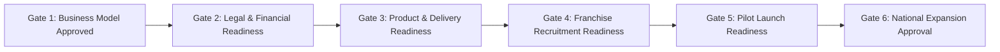

# Launch Gates & Critical Blocker Architecture

## 1. Overview
The **Launch Gates & Critical Blocker Architecture** provides the governance checkpoints that prevent premature capital expenditure, misleading partner recruitment, and operational failure during franchise expansion.

A launch gate is a mandatory, chronological stage-gate review. Passing a gate requires meeting quantitative completion thresholds and clearing all associated non-negotiable exit criteria. Critical blockers represent systemic defects or legal vulnerabilities that **veto gate passage automatically**, regardless of the overall workstream readiness percentage.

---

## 2. The Six Sequential Launch Gates

### Gate 1: Business Model Approved
- **Primary Domain:** Strategic Feasibility & Commercial Architecture.
- **Participating Workstreams:** Workstream 1 (Business Model & Commercial Strategy) and Workstream 4 (Finance, Banking & Accounting).
- **Gate Entry Criteria:** Franchise archetype selected (e.g., FOFO), fee tiers defined, baseline unit economics modeled.
- **Mandatory Exit Criteria:**
  - Break-even unit volume verified as achievable within normal territory density.
  - Payback period modeled at $\le 12$ months under Base Case assumptions.
  - Formal client executive sign-off recorded in approval matrix.
- **Approval Authority:** Corporate Managing Partner & Lead Franchise Strategy Consultant.

---

### Gate 2: Legal & Financial Readiness
- **Primary Domain:** Risk Insulation & Regulatory Compliance.
- **Participating Workstreams:** Workstream 2 (Legal, Regulatory & IP) and Workstream 4 (Finance, Banking & Accounting).
- **Gate Entry Criteria:** Draft agreements authored, commercial terms finalized.
- **Mandatory Exit Criteria:**
  - Master Franchise Agreement vetted and certified by qualified corporate legal counsel.
  - Statutory pass-through tax segregation (e.g., 18% GST) codified and reconciled.
  - TDS withholding protocols (Sec 194J/H) established.
  - Mandatory working capital reserve requirement ($\ge 4$ months fixed overhead) enforced.
- **Approval Authority:** Corporate Legal Counsel & Chief Financial Officer / Chartered Accountant.

---

### Gate 3: Product & Delivery Readiness
- **Primary Domain:** Technical Excellence & Software Scalability.
- **Participating Workstreams:** Workstream 3 (Multi-Product Sales Readiness) and Workstream 9 (Central Delivery & Support).
- **Gate Entry Criteria:** Product catalog finalized, base licensing tiers defined.
- **Mandatory Exit Criteria:**
  - 100% of commercial software products have production-stable demo instances and sales collateral.
  - Central support SLA escalation matrix established (Tier-1 local vs Tier-2/3 central engineering).
  - Cloud hosting infrastructure certified for 99.9% uptime with automated backup and disaster recovery.
  - Product demonstration guides and battlecards completed.
- **Approval Authority:** Lead Software Architect & Head of Customer Engineering.

---

### Gate 4: Franchise Recruitment Readiness
- **Primary Domain:** Marketing Integrity & Ethical Prospecting.
- **Participating Workstreams:** Workstream 7 (Franchise Recruitment & Marketing) and Workstream 10 (Partner Onboarding Documents).
- **Gate Entry Criteria:** Pitch deck outlined, brochures drafted.
- **Mandatory Exit Criteria:**
  - Comprehensive Franchise Prospectus and FAQ completed with statutory earnings claim disclaimers.
  - Partner qualification rubric and discovery day evaluation sheets ratified.
  - Partner KYC and proof-of-funds verification procedures established.
  - Early-bird promotional recruitment campaign ready for execution.
- **Approval Authority:** Head of Franchise Recruitment & Corporate Legal Counsel.

---

### Gate 5: Pilot Launch Readiness
- **Primary Domain:** Operational Field Deployment & Accreditation.
- **Participating Workstreams:** Workstream 5 (Franchise Operations & SOPs), Workstream 6 (Technology), Workstream 8 (Training & Certification), and Workstream 12 (Pilot Launch).
- **Gate Entry Criteria:** Recruitment materials active, initial partner candidates qualified.
- **Mandatory Exit Criteria:**
  - Comprehensive Franchise Operations Manual (SOP Handbook) completed and distributed.
  - Central partner portal deployed with CRM deal registration lock active.
  - 10-day training curriculum completed with 100% test pass rate for pilot franchisees.
  - First 3 pilot franchise agreements formally executed.
- **Approval Authority:** Franchise Operations Director & Client Managing Partner.

---

### Gate 6: National Expansion Approval
- **Primary Domain:** Institutional Scaling & Governance.
- **Participating Workstreams:** Workstream 11 (Governance & Performance Monitoring) and Workstream 12 (Pilot Launch & Final Approval).
- **Gate Entry Criteria:** Pilot franchise units operational for minimum 90 days.
- **Mandatory Exit Criteria:**
  - Pilot milestone revenue audit completed: actual sales velocity within $\pm 20\%$ of Base Case model.
  - Minimum 85% CSAT rating from end customers in pilot territories.
  - Operations manual and training programs refined based on empirical pilot learnings.
  - Territory expansion wave plan ratified for statewide/national rollout.
- **Approval Authority:** Board of Directors / Client Executive Leadership Committee.

---

## 3. Critical Blocker Taxonomy (Veto Conditions)

A **Critical Blocker** is defined as an operational, legal, financial, or technical flaw of such severity that releasing the franchise offering to the market would create existential regulatory liability, severe financial loss for partners, or brand destruction.

| Blocker ID | Workstream | Description | Root Cause / Threshold | Gate Vetoed | Resolution Requirement |
|---|---|---|---|---|---|
| **BLK-001** | Legal & IP | **Unvetted Franchise Contract** | Franchise agreements issued to candidates without formal written certification from corporate legal counsel. | Gate 2, 4 | Formal legal opinion and signed compliance memo from practicing counsel. |
| **BLK-002** | Finance & Tax | **Tax Pass-Through Non-Segregation** | Commission calculations or partner quotes derived from tax-inclusive gross customer billings. | Gate 2 | Mathematical engine update isolating 18% GST and re-quantizing splits on Net Realized Revenue. |
| **BLK-003** | Product & Tech | **Unstable Demo Environment** | Software products crash during sales demonstrations or lack multi-tenant sandbox environments. | Gate 3 | Deployment of dedicated cloud demo instances with pre-loaded dummy data and 99.9% uptime. |
| **BLK-004** | Support & Delivery | **Undefined SLA Escalation** | No formal ticketing system or central engineering commitment for P1 critical bugs (< 2h response). | Gate 3, 5 | Implementation of centralized ticketing workflow with published support SLA matrix signed by tech lead. |
| **BLK-005** | Investor Protection | **Inadequate Working Capital Reserve** | Candidate approved with liquid reserves lower than mandatory 4–6 month fixed operational burn. | Gate 4, 5 | Strict bank statement proof-of-funds verification showing unencumbered working capital cushion. |
| **BLK-006** | Pilot & Strategy | **Unvalidated Pilot Verification** | Full-scale recruitment launched prior to completing 90-day pilot revenue audit and customer satisfaction survey. | Gate 6 | Execution of 90-day pilot audit report reconciling projected vs actual unit cash flows. |
| **BLK-007** | Governance | **Unenforced Territory Protection** | Absence of CRM deal registration lock allowing multiple franchisees to compete for identical client accounts. | Gate 5 | Technical enforcement of 90-day deal registration lock in central partner portal CRM. |

---

## 4. Blocker Governance & Override Protocol

1. **Zero Unilateral Overrides:** No single analyst, recruiter, or operations lead may waive a Critical Blocker.
2. **Formal Risk Acceptance Memo:** If executive leadership elects to override a non-legal blocker (e.g., launching with 2 pilot units instead of 3), an official **Risk Acceptance Resolution** must be logged in `clients/<client-slug>/decisions/` signed by the Managing Partner and Chief Legal Officer detailing the mitigation plan and sunset date.
3. **Legal Blockers are Non-Overridable:** `BLK-001` (Unvetted Legal Contract) and `BLK-002` (Statutory Tax Non-Compliance) can NEVER be overridden under any circumstances.
