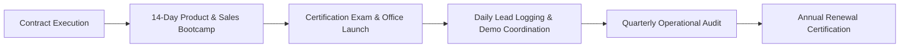

# Franchise Operations Governance & Enablement Framework

## 1. Purpose
This framework establishes operational governance, standard operating procedures (SOPs), quality auditing protocols, and training enablement mechanisms to ensure consistent brand standards and high customer satisfaction across all franchise locations.

---

## 2. Business Questions Addressed
1. What standardized operational workflows govern franchisee onboarding, daily sales operations, demo scheduling, customer onboarding, and renewal management?
2. How does the franchisor conduct remote and on-site quality compliance audits?
3. What structured training curriculum is required before a franchisee salesperson is certified to sell products?
4. What are the service level agreements (SLAs) for technical escalation, bug fixes, and customer onboarding?

---

## 3. Required Inputs
- **Product Operational Workflows:** Step-by-step user journey from demo request to cloud provisioning.
- **Support SLA Tiers:** Severity-1 (system down), Severity-2 (major impairment), Severity-3 (general query).
- **Audit Checklist Parameters:** Office branding, staff competency, lead registration compliance, reporting timeliness.

---

## 4. Methodology & Operational Lifecycle

### 4.1. Core Operational Workflows
1. **Onboarding & Setup (Days 1–14):** Physical office inspection, CRM user provisioning, product knowledge transfer, and sales collateral distribution.
2. **Lead-to-Demo Workflow:** Lead logged in CRM -> Qualification checklist -> Franchisee coordinates demo date -> Franchisor solution architect co-leads technical presentation -> Franchisee issues standardized quote.
3. **Delivery Handover Workflow:** Customer payment confirmed -> Central billing generates GST invoice -> Franchisor engineering deploys instance -> Welcome email and training delivered to customer.
4. **Quarterly Operational Audit:** Evaluating 20 inspection points covering CRM hygiene, brand presentation, salesperson turnover, and customer satisfaction ratings.

---

## 5. Calculation Logic & Audit Compliance Index

$$\text{Operational Compliance Score } (OCS) = \frac{\sum_{i=1}^{N} w_i \cdot s_i}{\sum_{i=1}^{N} w_i} \times 100\%$$
Where:
- $w_i$ = Weight of operational checkpoint $i$.
- $s_i$ = Audit score (1 = Fully Compliant, 0.5 = Partially Compliant, 0 = Non-Compliant).
- Passing Grade: $OCS \ge 80\%$.

---

## 6. Expected Outputs
1. **Franchise Operations Manual (`templates/operations-manuals/franchise-operations-manual.template.md`).**
2. **Salesperson Training Playbook (`templates/sales-playbooks/salesperson-training-manual.template.md`).**
3. **Support SLA Matrix.**

---

## 7. Risks and Limitations
- **Operational Drift:** Franchisees gradually stop logging leads in the central CRM if enforcement is lax.
- **High Salesperson Turnover:** Rapid turnover at local offices requires continuous, modular digital training courses.

---

## 8. Acceptance Criteria
- Complete training curriculum and certification test must be documented prior to onboarding first franchisee.
- SLA matrix must clearly define resolution windows for all product tiers.

---

## 9. Example Application: TMK IT Solutions LLP
- **SLA Commitment:** TMK technical team commits to provision School ERP cloud instances within 24 hours of customer payment verification, and deliver initial staff training within 5 business days.
