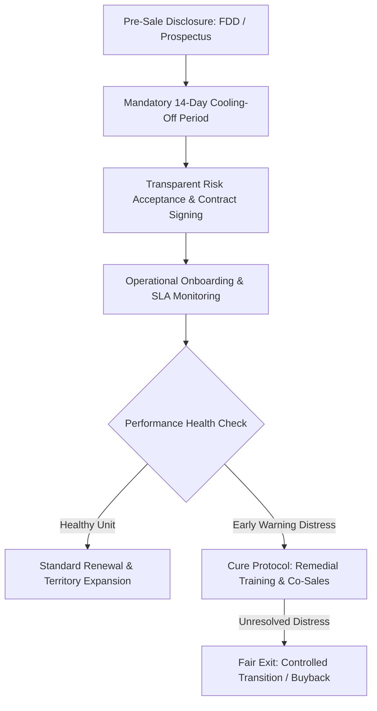

# Franchisee & Investor Protection Framework

## 1. Purpose
This framework establishes rigorous institutional governance, risk disclosure standards, ethical sales practices, and dispute mitigation mechanisms for franchise offerings. It protects prospective franchisees and commercial investors from misleading earnings claims, hidden costs, unverified business models, and unfair exit covenants, while safeguarding the franchisor against reputational and legal liabilities.

---

## 2. Business Questions Addressed
1. What mandatory financial and operational disclosures must be presented to prospective franchisees prior to collecting joining fees?
2. How are earnings projections qualified to prevent unlawful or deceptive profit promises?
3. What franchisor support commitments (training hours, lead assistance, technical support SLAs) are contractually guaranteed?
4. What early-warning triggers identify underperforming units before financial distress becomes irreversible?
5. What constitutes a fair, orderly exit policy with transparent fee refunds or territory transitions?

---

## 3. Required Inputs
- **Historical Unit Economics:** Empirical performance data from pilot or operating units (gross revenue, average deal size, churn).
- **Comprehensive Cost Schedule:** Full itemization of joining fees, software training charges, mandatory technology fees, and local office setup estimates.
- **Franchisor SLA Commitments:** Defined response times for software bug fixes, server uptime guarantees, and field demonstration support.
- **Legal Cooling-Off Regulations:** Applicable statutory waiting periods between disclosure delivery and contract execution.

---

## 4. Methodology & Governance Architecture

### 4.1. The Seven Pillars of Investor Protection
1. **Mandatory Itemized Disclosure:** All fees, ongoing royalties, software subscriptions, and required third-party outlays must be disclosed upfront in a formal Franchise Disclosure Document (FDD) or Prospectus.
2. **Realistic Earnings Representations:** Projections must never be labeled as "guaranteed income" or "risk-free yield." Projections must include conservative scenarios demonstrating the financial impact of below-target sales velocity.
3. **Operational Readiness Audit:** Franchisor must certify software stability and operational training playbooks prior to onboarding franchisees in any product line.
4. **Contractual Support Service Level Agreements (SLAs):** Specific franchisor support commitments (e.g., product demo support within 24 hours, cloud uptime 99.5%) must be written into agreements with remedies for non-performance.
5. **Early Warning Health Monitoring:** Monthly financial tracking to identify struggling franchisees within their first 90 days.
6. **Remedial Action ("Cure") Protocol:** A structured 60-day intervention process providing remedial training, franchisor co-sales assistance, and fee relief before declaring default.
7. **Equitable Exit & Transfer Rights:** Defined rules allowing franchisees to sell their territory to an approved successor or exit with partial refund if the franchisor breaches operational commitments.

---

## 5. Calculation Logic & Early Warning Health Index

### 5.1. Unit Health Index ($UHI$)
Monitored monthly for every active franchise unit:
$$UHI_m = 0.35 \cdot \left(\frac{V_{actual,m}}{V_{target,m}}\right) + 0.35 \cdot \left(\frac{EBITDA_{actual,m}}{EBITDA_{target,m}}\right) + 0.15 \cdot \left(\frac{W_{remaining,m}}{OpEx_{monthly}}\right) + 0.15 \cdot C_{training}$$
Where:
- $V_{actual} / V_{target}$ = Sales volume achievement ratio.
- $W_{remaining} / OpEx_{monthly}$ = Months of working capital runway remaining.
- $C_{training}$ = Franchisee staff training compliance score (0.0 to 1.0).

### 5.2. Action Triggers
- **$UHI \ge 0.85$ (Green - Healthy):** Eligible for multi-unit territory expansion.
- **$0.60 \le UHI < 0.85$ (Yellow - Watchlist):** Weekly coaching call; franchisor provides additional joint product demos.
- **$UHI < 0.60$ for 2 consecutive months (Red - Critical):** Trigger formal 60-day Remedial Plan.

---

## 6. Expected Outputs
1. **Franchise Investor Risk Disclosure Document (`templates/investor-presentations/investor-risk-disclosure.template.md`).**
2. **Unit Operational Health Scorecard.**
3. **Fair Exit & Transition Protocol.**

---

## 7. Risks and Limitations
- **Franchisee Non-Disclosure:** Struggling franchisees may delay submitting monthly sales figures, concealing cash burn.
- **Market Shocks:** External macroeconomic downturns can impair unit economics regardless of franchisee diligence.

---

## 8. Acceptance Criteria
- Every franchise marketing document must include the mandatory Investor Risk Disclosure notice.
- Financial projections must explicitly display the working capital burn runway under zero-sales conditions.

---

## 9. Example Application: TMK IT Solutions LLP
- **Risk Disclosure Covenants:**
  - Promotional joining fee (₹25,000) is explicitly declared non-refundable after completion of the 14-day technical training bootcamp.
  - The 40% commission is earned strictly upon customer payment receipt by franchisor.
  - Mandatory working capital reserve of ₹1,50,000 (approx. 4 months of fixed office and salesperson costs) is verified during onboarding due diligence to ensure the franchisee does not run out of funds during the initial 90-day sales ramp.
