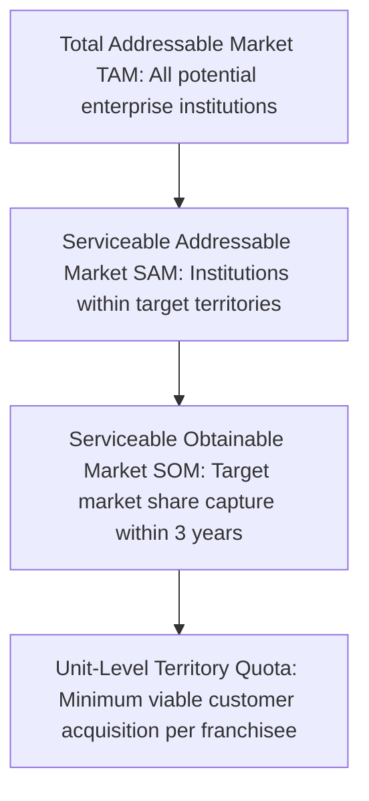

# Franchise Market Research & Sizing Methodology

## 1. Purpose
This framework provides a repeatable, empirical methodology for researching prospective franchise markets. It establishes standard analytical procedures to size addressable opportunities (TAM, SAM, SOM), profile customer segments, benchmark competitor pricing, and evaluate market attractiveness prior to capital allocation.

---

## 2. Business Questions Addressed
1. What is the Total Addressable Market (TAM), Serviceable Addressable Market (SAM), and Serviceable Obtainable Market (SOM) for each product vertical?
2. Which specific customer sub-segments (e.g., private K-12 schools vs. degree colleges) exhibit the highest willingness to pay and shortest sales cycles?
3. What are the dominant competitor solutions, their pricing models, distribution channels, and documented feature gaps?
4. What pricing strategy (penetration, value-based, modular add-on) maximizes adoption while supporting viable franchise commissions?

---

## 3. Required Inputs
- **Demographic & Industry Data:** Census data, state-level enterprise registers, school/university directories, commercial property statistics.
- **Economic Indicators:** Regional GDP, per-capita business spend, tech adoption rates, internet connectivity.
- **Competitor Baseline:** Product tiering, public pricing lists, customer reviews, software review platforms (e.g., G2, Capterra), and local distributor markups.
- **Channel Dynamics:** Direct sales vs. value-added reseller (VAR) vs. digital self-service.

---

## 4. Methodology & Sizing Framework

### 4.1. Five-Phase Research Workflow
1. **Secondary Industry Profiling:** Review official government education/MSME databases and trade body reports.
2. **Competitor Matrix Benchmarking:** Catalog direct and indirect competitors across 5 vectors: Price, Deployment Model (Cloud vs. Desktop), Feature Breadth, Local Support Quality, and Channel Structure.
3. **Primary Field Interviews:** Conduct structured 15-minute discovery calls with target buyers (e.g., school principals, accounting managers, property managers) to validate core pain points.
4. **Willingness-to-Pay (WTP) Curve:** Estimate price elasticity using the Van Westendorp Price Sensitivity Meter or Gabor-Granger technique.
5. **Synthesis & Evidence Logging:** Log every cited datapoint in the centralized `research-evidence-register.md`.

---

## 5. Calculation Logic & Market Sizing

### 5.1. Market Sizing Formulation
- **Total Addressable Market (TAM):**
  $$TAM = N_{total\_entities} \times \bar{P}_{annual\_spend}$$
- **Serviceable Addressable Market (SAM):**
  $$SAM = N_{target\_territory\_entities} \times \bar{P}_{annual\_spend} \times \%_{\text{tech\_ready}}$$
- **Serviceable Obtainable Market (SOM - Year 3):**
  $$SOM_{Y3} = SAM \times \text{Target Penetration Rate } (e.g., 2\% - 5\%)$$

### 5.2. Market Attractiveness Index ($MAI$)
$$MAI = 0.30 \cdot S_{density} + 0.25 \cdot S_{growth} + 0.20 \cdot S_{margin} + 0.15 \cdot S_{comp\_gap} + 0.10 \cdot S_{readiness}$$
Where each $S$ score ranges from 1 (unfavorable) to 5 (highly favorable).

---

## 6. Expected Outputs
1. **Market Opportunity Brief** per product vertical.
2. **Competitor Landscape Matrix** with feature parity analysis.
3. **Customer Persona Archetypes** with decision-maker pain points.
4. **Verified Evidence Log Entries** in `analyst-workspace/research-methodology/research-evidence-register.md`.

---

## 7. Risks and Limitations
- **Secondary Data Staleness:** Government directories may list non-operational schools or defunct businesses.
- **Willingness-to-Pay Bias:** Stated survey intent frequently exceeds actual budget authorization when contracts are presented.

---

## 8. Acceptance Criteria
- Every market sizing claim must cite verifiable source data (directory, census, or field survey).
- No assumed market size may be stated without clearly specifying the underlying entity count and average selling price.

---

## 9. Example Application: TMK IT Solutions LLP — School/College ERP
- **Geographic Focus:** Tier-2 and Tier-3 districts in Maharashtra and Gujarat.
- **Territory Pool (Sample District):** 450 private and aided schools.
- **Tech-Ready SAM:** 60% of schools seeking digital attendance, fees, and report cards = 270 schools.
- **Target SOM (Year 1 per Franchisee):** 5% capture = 13 to 14 schools.
- **Economic Value:** $14 \times ₹60,000 = ₹8,40,000$ net software sales in Year 1 for a single dedicated taluka franchisee.
