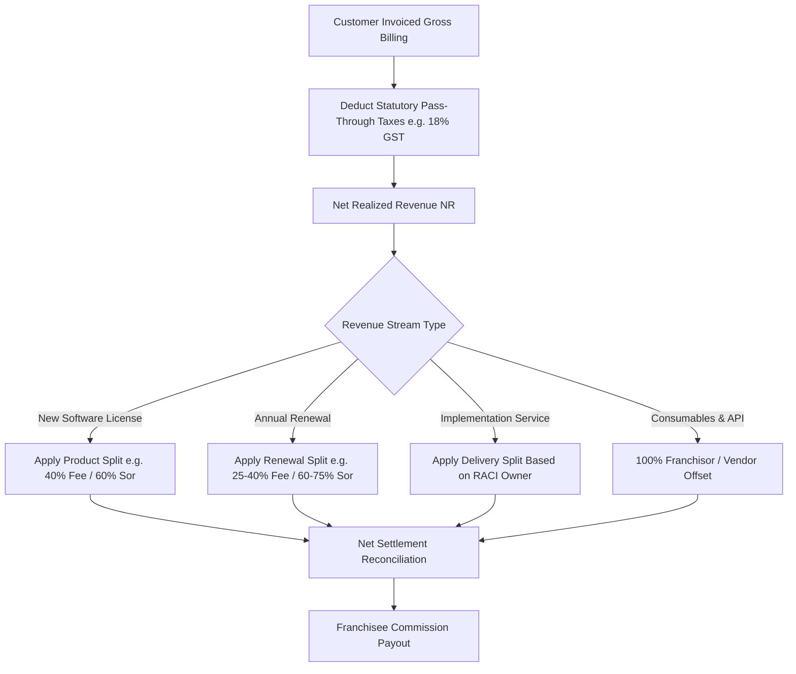

# Configurable Revenue-Sharing & Commercial Settlement Framework

## 1. Purpose
This framework provides an architectural methodology to parameterize, calculate, and govern revenue-sharing contracts between franchisors and franchisees. It eliminates rigid, hardcoded commission splits by supporting multi-tier product categories, distinct revenue types (new licenses, renewals, setup fees), tax adjustments, infrastructure cost offsets, and chargeback treatments.

---

## 2. Business Questions Addressed
1. How is gross customer billing decomposed into statutory taxes, infrastructure pass-throughs, franchisor shares, and franchisee commissions?
2. Does the standard product split (e.g., 40:60) apply identically to initial software licenses, on-site implementation fees, and annual renewals?
3. How are third-party cloud infrastructure costs (e.g., AWS server hosting, SMS gateway credits, WhatsApp API fees) treated before or after margin distribution?
4. What is the contractual settlement process for customer refunds, cancellations, and bad debts?

---

## 3. Required Inputs
- **Invoice Structure:** Gross amount, GST / Sales tax rate (e.g., 18%), and invoice payment status.
- **Revenue Stream Categorization:**
  - `NEW_LICENSE`: Initial software license acquisition.
  - `ANNUAL_RENEWAL`: Recurring annual software maintenance / subscription.
  - `IMPLEMENTATION_FEE`: Setup, custom data migration, and training charges.
  - `INFRASTRUCTURE_CONSUMABLE`: Pass-through cloud server, SMS, or third-party API fees.
- **Contractual Sharing Rules:** Configured sharing percentages per revenue stream ($S_{fee,type}, S_{sor,type}$).
- **Settlement Frequency:** Monthly cut-off dates, payment credit cycles, and minimum reconciliation thresholds.

---

## 4. Methodology & Flow of Funds

---

## 5. Calculation Logic & Settlement Order

### 5.1. Waterfall Deduction Formula
For any customer transaction $i$:
1. **Extract Gross and Tax:**
   $$\text{Gross Billing } (G_i) = \text{Net Revenue } (NR_i) \cdot (1 + r_{tax})$$
   $$\text{Tax Remittance } (TAX_i) = G_i - NR_i$$
2. **Third-Party Infrastructure Pass-Through Offset ($C_{infra,i}$):**
   Certain software subscriptions incur direct variable vendor costs (e.g., WhatsApp Business messaging or dedicated AWS RDS instance). Where contractually agreed:
   $$\text{Distributable Net Revenue } (DNR_i) = \max(0, NR_i - C_{infra,i})$$
3. **Partition by Stream Type:**
   - **Franchisee Share:**
     $$COMM_{fee,i} = DNR_i \cdot S_{fee}(\text{type}_i, \text{product}_i)$$
   - **Franchisor Retained Share:**
     $$REV_{sor,i} = DNR_i \cdot (1 - S_{fee}(\text{type}_i, \text{product}_i)) + C_{infra,i}$$

### 5.2. Treatment of Implementation & Services Fees
Where the franchisor central technical engineering team executes 100% of on-site/remote software implementation, data migration, and technical configuration, the implementation fee split is decoupled from the sales commission:
- Standard default: 80% Franchisor (Delivery Cost Recovery) / 20% Franchisee (Local Demo & Coordination).

### 5.3. Refund & Chargeback Clawback Mechanism
If a customer cancels within the warranty period (e.g., 30-day money-back guarantee):
$$CLAWBACK_{fee} = -1 \cdot COMM_{fee,original}$$
The clawback amount is debited against the franchisee's subsequent monthly settlement ledger.

---

## 6. Expected Outputs
1. **Configurable Revenue Sharing Rule Schema (`revenue-sharing.schema.json`).**
2. **Monthly Settlement Statement Template** showing gross billing, tax breakdown, product-wise commission, and net payout.
3. **Audit Trail Log** tracking reconciliation between customer payment receipts and franchisee commission disbursements.

---

## 7. Risks and Limitations
- **Commingling Tax with Commission:** Calculating commissions on GST-inclusive amounts inflates payout by 18%, causing severe operational losses to the franchisor.
- **Renewal Disincentive:** Setting renewal commissions too low (e.g., < 15%) causes franchisees to ignore existing customers, driving up churn.

---

## 8. Acceptance Criteria
- Tax amounts are strictly segregated and excluded from distributable commission pools.
- Sum of franchisee share and franchisor share for any distributable stream equals exactly 100%.

---

## 9. Example Application: TMK IT Solutions LLP
- **Scenario:** Customer purchases School ERP at ₹70,800 gross (inclusive of 18% GST).
  - Net Revenue: $\frac{₹70,800}{1.18} = ₹60,000$.
  - GST Remittance (Govt): $₹10,800$.
  - Distributable Net Revenue: $₹60,000$.
  - Franchisee Commission (40%): $₹24,000$.
  - Franchisor Retained Revenue (60%): $₹36,000$.
  - In Year 2, customer renews software maintenance at ₹20,000 net:
    - Franchisee Renewal Share (40%): ₹8,000.
    - Franchisor Central Support Share (60%): ₹12,000.
