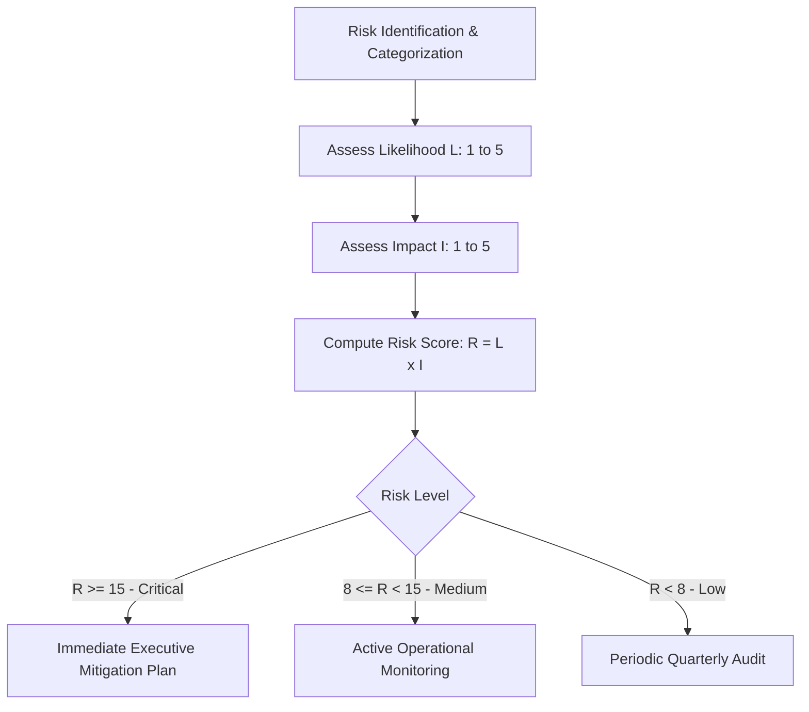

# Franchise Risk Assessment & Mitigation Framework

## 1. Purpose
This framework provides a standardized methodology to identify, score, track, and mitigate operational, financial, legal, brand, and market risks across the lifecycle of a franchise network.

---

## 2. Business Questions Addressed
1. What are the highest-probability and highest-impact failure modes across the franchise ecosystem?
2. How do we quantify franchisee insolvency risk before it leads to territory abandonment?
3. What legal and brand contamination risks arise from unauthorized franchisee representations?
4. What mitigation playbooks prevent product delivery bottlenecks as unit count scales?

---

## 3. Required Inputs
- **Risk Taxonomy:** Operational, Financial, Legal/Compliance, Brand/Reputational, Technical/Delivery.
- **Historical Loss / Dispute Data:** Past customer refund requests, franchisee complaints, trademark disputes.
- **Contractual Terms:** Audit rights, indemnity covenants, termination clauses.

---

## 4. Methodology & Risk Scoring Engine

---

## 5. Calculation Logic & Matrix

$$\text{Risk Exposure Score } (RES) = \text{Likelihood } (L \in [1,5]) \times \text{Impact } (I \in [1,5])$$

| Severity Level | Score Range | Action Required | Escalation Threshold |
|---|---|---|---|
| **Critical** | 15 - 25 | Immediate containment; weekly executive reporting; contractual cure notice. | Practice Lead & Client Executive |
| **Moderate** | 8 - 14 | Operational adjustment; enhanced support; training intervention. | Assigned Lead Analyst |
| **Low** | 1 - 7 | Monitor during standard quarterly reviews. | Field Operations Team |

---

## 6. Expected Outputs
1. **Franchise Risk Register (`clients/<client>/risks/risk-register.md`).**
2. **Mitigation Playbooks** for top 5 critical franchise failure modes.

---

## 7. Risks and Limitations
- **Optimism Bias:** Analysts may underestimate local competitive response or customer sales resistance.
- **Unenforceable Clauses:** Covenants in franchise agreements that are deemed unreasonable by local courts (e.g., excessive non-compete clauses) will fail.

---

## 8. Acceptance Criteria
- Every identified risk must have an assigned owner, target resolution date, and concrete mitigation actions.

---

## 9. Example Application: TMK IT Solutions LLP
- **Risk:** Franchisee salesperson misrepresents software capabilities during School ERP pitch, promising custom modules not supported by TMK core code.
  - Likelihood: 4, Impact: 4, Risk Score = 16 (Critical).
  - Mitigation Playbook: Implement mandatory recorded demo scripts, standardized proposal templates, and franchisor technical validation sign-off before contract binding.
