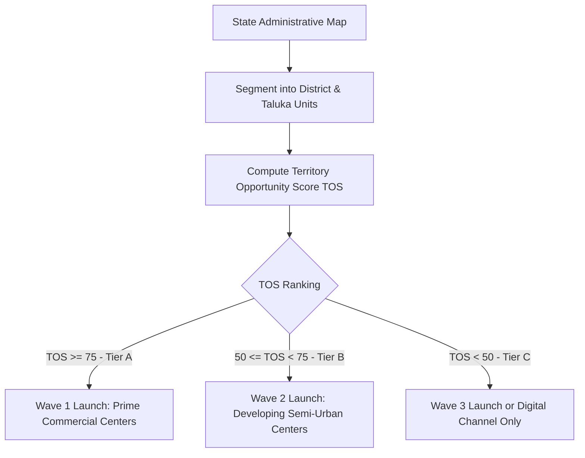

# Territory Intelligence & Opportunity Prioritization Framework

## 1. Purpose
This framework establishes a scientific, geospatial approach to designing, evaluating, and allocating franchise territories. It defines quantitative opportunity scoring heuristics, territory boundary definitions (e.g., Taluka, District, Postal Code), customer density estimation, and conflict prevention rules to ensure sustainable unit economics for every franchisee while maximizing brand market coverage.

---

## 2. Business Questions Addressed
1. What geographical unit of division (Taluka/Tehsil, District, PIN code cluster, or Metro zone) provides the optimal balance of market potential and manageable operational span?
2. How many qualified commercial targets (schools, businesses, real estate properties) are physically located within a designated boundary?
3. How do we prevent channel conflict and customer poaching between adjacent franchisees?
4. Which territories should be prioritized for Wave 1 launch versus Wave 2 and Wave 3 expansion?

---

## 3. Required Inputs
- **Administrative Boundary Classifications:** State, District, and Taluka/Tehsil boundary data.
- **Enterprise Density Metrics:** Number of registered educational institutions, MSME enterprises, and commercial establishments per administrative unit.
- **Economic Prosperity Indicators:** District Domestic Product (DDP), commercial bank credit, urbanization percentage, and broadband penetration.
- **Franchise Capacity Constraint:** Minimum addressable market required to sustain 1 full-time office and 1 dedicated salesperson at break-even ($N_{min\_targets}$).

---

## 4. Methodology & Territory Allocation Engine

### 4.1. Rules of Territory Demarcation & Exclusivity
1. **Clear Geographic Enclosures:** Territories must follow established government administrative boundaries (e.g., Taluka/Tehsil in India) rather than arbitrary radial distance circles, which frequently intersect municipal borders.
2. **First-Right Customer Registry:** When a franchisee logs a prospect in the central CRM with documented contact, that prospect is locked to the franchisee for 90 days, preventing boundary poaching.
3. **Cross-Border Lead Routing:** If an enterprise customer has operations spanning multiple territories, the lead is handled via a defined multi-unit revenue attribution rule (e.g., 60% originating territory / 40% delivery territory).

---

## 5. Calculation Logic & Opportunity Scoring

### 5.1. Territory Opportunity Score ($TOS$)
For any geographic territory $j$:
$$TOS_j = w_1 \cdot D_{target,j} + w_2 \cdot E_{wealth,j} + w_3 \cdot I_{infra,j} - w_4 \cdot C_{comp,j}$$
Where:
- $D_{target,j}$ = Target customer density score (normalized 0 to 100).
- $E_{wealth,j}$ = Economic vitality index (commercial tax revenue / GDP index).
- $I_{infra,j}$ = Digital infrastructure readiness (broadband, business connectivity).
- $C_{comp,j}$ = Incumbent competitor saturation penalty.
- Recommended Weights: $w_1 = 0.45, w_2 = 0.25, w_3 = 0.15, w_4 = 0.15$.

### 5.2. Minimum Sustainable Market Sizing ($MSMS$)
A territory is deemed commercially viable for a dedicated full-time office only if:
$$\text{Total Qualified Prospects in Territory } (Q_j) \ge \frac{V_{annual\_breakeven}}{\text{Target Annual Market Share } (e.g., 3\%)}$$
For example, if annual break-even requires 18 software sales:
$$Q_j \ge \frac{18}{0.03} = 600 \text{ addressable institutions}$$

---

## 6. Expected Outputs
1. **Territory Master Inventory:** Master table of prioritized districts and talukas categorized by Wave (Wave 1, Wave 2, Wave 3).
2. **Territory Scoring Heatmap / GIS Coordinates.**
3. **Territory Boundary Policy Document** preventing channel conflict.

---

## 7. Risks and Limitations
- **Unequal Taluka Sizes:** In rural regions, talukas may cover massive geographical areas with low enterprise density, increasing salesperson travel expenses.
- **Data Inconsistency:** District-level statistical handbooks may lag by 2 to 3 years.

---

## 8. Acceptance Criteria
- Every allocated territory must meet or exceed the Minimum Sustainable Market Sizing ($MSMS$) threshold.
- Boundaries must be unambiguous, mutually exclusive, and collectively exhaustive within the contracted region.

---

## 9. Example Application: TMK IT Solutions LLP
- **Territory Model:** Taluka-based exclusive sales territory.
- **Pilot Region:** Pune District, Maharashtra.
  - Haveli Taluka (includes semi-urban IT & education hubs): $TOS = 88.4$ (Wave 1 Priority, 1,200+ target schools/businesses).
  - Baramati Taluka: $TOS = 74.2$ (Wave 1 Priority, 550+ target schools/cooperatives).
  - Junnar Taluka: $TOS = 58.1$ (Wave 2 Priority, 380+ target schools).
