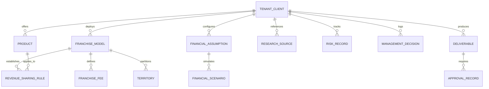

# Platform Domain Entity Model

## 1. Domain Overview

The Franchise Business Modeling & Intelligence Platform represents franchise concepts, commercial relationships, unit economics, and operational policies through a formal domain model.

---

## 2. Entity-Relationship Diagram

---

## 3. Core Entity Specifications

### 3.1. Tenant / Client (`Client`)
- **Description:** The enterprise organization whose business is being franchised (e.g., TMK IT Solutions LLP).
- **Attributes:** `clientId` (string/slug), `legalName`, `industryType`, `operatingCountry`, `baseCurrency`, `contactEmail`, `status`.

### 3.2. Product (`Product`)
- **Description:** A commercial product or service offered by the franchisor through the franchise network.
- **Attributes:** `productId`, `clientId`, `name`, `category`, `deliveryModel` (SaaS, On-Premise, Hybrid), `targetCustomerSegment`, `pricingModel` (Recurring Annual, Perpetual, Per-Seat), `indicativePrice`, `implementationFee`.

### 3.3. Franchise Model (`FranchiseModel`)
- **Description:** The structural archetype governing the commercial relationship between franchisor and franchisee.
- **Attributes:** `modelId`, `clientId`, `archetype` (`FOFO`, `FOCO`, `COCO`, `Master`, etc.), `ownerRequirements` (min offices, min staff), `contractTermMonths`.

### 3.4. Franchise Fee (`FranchiseFee`)
- **Description:** Joining or franchise development fees required to enter the network.
- **Attributes:** `feeId`, `clientId`, `modelId`, `productId` (optional if bundled), `tier` (`promotional`, `regular`, `renewal`), `amount`, `currency`, `taxStatus`, `refundabilityTerms`.

### 3.5. Revenue Sharing Rule (`RevenueSharingRule`)
- **Description:** The parameterized calculation contract governing how customer billings are split between franchisor and franchisee.
- **Attributes:** `ruleId`, `clientId`, `productId`, `revenueType` (`software_license`, `annual_renewal`, `implementation`, `custom_service`), `franchiseeSharePercent`, `franchisorSharePercent`, `taxDeductionOrder`, `thirdPartyInfraDeductionOrder`.

### 3.6. Financial Assumption (`FinancialAssumption`)
- **Description:** An explicit quantitative parameter driving unit economics and cash flow projections.
- **Attributes:** `assumptionId`, `clientId`, `category` (`sales_velocity`, `operating_cost`, `churn_rate`, `headcount`), `name`, `baseValue`, `unit`, `sourceEvidenceId`, `verificationStatus`.

### 3.7. Financial Scenario (`FinancialScenario`)
- **Description:** A scenario-specific set of values (`conservative`, `base`, `optimistic`) representing distinct market conditions.
- **Attributes:** `scenarioId`, `clientId`, `name`, `growthRateMultiplier`, `conversionRateMultiplier`, `costEscalationFactor`.

### 3.8. Territory (`Territory`)
- **Description:** A geographic area allocated to a franchisee with defined exclusivity and density metrics.
- **Attributes:** `territoryId`, `clientId`, `name`, `type` (`taluka`, `district`, `state`, `metro_zone`), `demographicScore`, `addressableCustomersCount`, `exclusivityPolicy`.

### 3.9. Deliverable & Approval (`Deliverable`, `ApprovalRecord`)
- **Description:** Institutional assets generated by analysts requiring formal quality and client sign-off.
- **Attributes:** `deliverableId`, `clientId`, `title`, `type` (`excel_model`, `pitch_deck`, `agreement`, `prospectus`), `status` (`draft`, `peer_reviewed`, `approved`), `approvedBy`, `approvalDate`.
