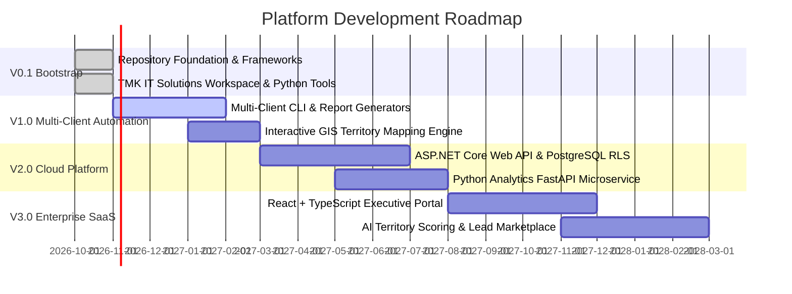

# Platform Strategic Roadmap (V0.1 to V3.0)

## 1. Roadmap Overview

The Franchise Business Modeling & Intelligence Platform follows an aggressive, structured trajectory transitioning from an analyst-driven Git repository into an enterprise multi-tenant SaaS intelligence platform.

---

## 2. Release Milestones

---

## 3. Milestone Details

### Version 0.1: Repository Bootstrap (Current Release)
- **Focus:** Foundations, standardized frameworks, Python calculation engine, openpyxl Excel generator, JSON schemas, automated validation suite, and TMK IT Solutions inaugural client workspace.
- **Key Deliverables:** 11 business frameworks, 15+ templates, 6 software product profiles, editable dynamic Excel model, starter pitch deck, and dual-analyst command center.

### Version 1.0: Multi-Client Automation & GIS Mapping (Q1 2027)
- **Focus:** Scaled analyst workflows and spatial intelligence.
- **Key Deliverables:**
  - Standardized client ingestion CLI (`platform-cli client create --industry ...`).
  - Automated PDF report compilation with WeasyPrint / Pandoc.
  - Taluka-level GIS geospatial mapping for Indian territories to visualize franchisee exclusivity radii and market penetration.
  - Multi-client comparative benchmarking dashboard.

### Version 2.0: Cloud-Native API & Multi-Tenant Database (Q3 2027)
- **Focus:** Backend infrastructure and enterprise security.
- **Key Deliverables:**
  - ASP.NET Core 8 Web API implementing Clean Architecture and CQRS (MediatR).
  - PostgreSQL multi-tenant database with Row-Level Security (RLS) and schema isolation.
  - Python calculation engine deployed as an asynchronous FastAPI microservice with Celery workers for Monte Carlo simulations.
  - Role-Based Access Control (RBAC) supporting Enterprise Sponsors, Practice Leads, Analysts, and Prospective Franchisees.

### Version 3.0: Enterprise SaaS Portal & AI Territory Intelligence (Q1 2028)
- **Focus:** Self-service interactive client portal and AI-assisted franchise optimization.
- **Key Deliverables:**
  - High-performance web application in React 19 + TypeScript with dynamic modeling sliders, sensitivity graphs, and interactive financial sheets.
  - Machine learning territory scoring algorithm integrating census demographics, commercial GST registrations, and local competition density.
  - Automated franchise recruitment portal enabling prospective franchisees to submit applications, review disclosure prospectuses, and track qualification status.
