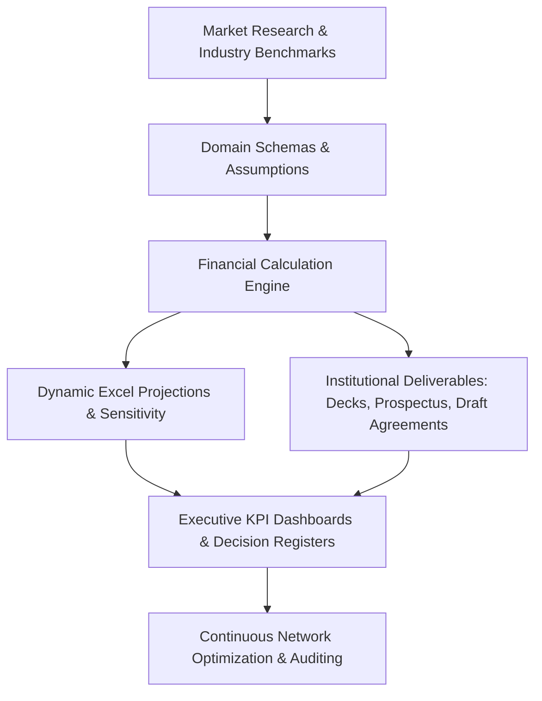

# Platform Vision: Franchise Business Modeling & Intelligence Platform

## 1. The Strategic Opportunity

Franchising powers trillions of dollars in global commerce across sectors ranging from Quick Service Restaurants (QSR) and retail to healthcare, education, and software. However, despite the massive scale of franchise ecosystems, the methodology for **conceiving, modeling, pitching, and governing franchise businesses** remains archaic.

Today's franchise consulting and corporate expansion workflows are plagued by:
1. **Unsubstantiated Financial Promises:** Pitch decks commonly promise rapid payback periods without transparent unit economics or sensitivity testing.
2. **Spreadsheet Fragility:** Critical financial models live in disconnected, error-prone desktop spreadsheets with hardcoded values, lacking version control or auditability.
3. **Ambiguous Operating Interfaces:** Franchise agreements often gloss over the daily boundary between franchisee and franchisor responsibilities, creating conflict over technical support, lead generation, and billing.
4. **Disorganized Market Expansion:** Territory allocation is frequently driven by opportunistic sales rather than data-driven market density and taluka/district potential.

The **Franchise Business Modeling & Intelligence Platform** solves these challenges by treating franchise development as a rigorous, data-driven, engineering discipline.

---

## 2. Core Pillars of the Platform

### Pillar 1: Client Independence and Multi-Industry Universality
The platform provides a generalized engine capable of modeling any commercial relationship structure (FOFO, FOCO, COCO, Master Franchise, Area Development). Whether modeling a cloud software franchise in India or a diagnostic healthcare chain in Southeast Asia, the platform separates core economic abstractions from industry-specific parameters.

### Pillar 2: Mathematical Rigor & Decimal-Safe Economics
Financial credibility is non-negotiable. All financial projections are computed via an auditable calculation engine employing high-precision decimal arithmetic, explicit tax separation (e.g., GST), working capital decay modeling, subscription renewal compounding, and multi-scenario stress tests.

### Pillar 3: Automated Institutional Deliverables
Rather than writing presentations and contracts manually, the platform synthesizes research, assumptions, and financial outputs directly into institutional-grade artifacts: dynamic Excel models, investor pitch decks, franchise prospectuses, operating handbooks, and draft legal agreements.

### Pillar 4: Centralized Intelligence & Assumption Traceability
Every parameter—from customer acquisition cost to salesperson productivity—is backed by an explicit entry in an assumptions register, linked to research evidence, and subject to peer review.

---

## 3. Platform Operating Model (V0.1 to V3.0)

---

## 4. Architectural Boundaries

- **Frameworks are Shared:** All business models, feasibility methodologies, and risk frameworks are modular and client-neutral.
- **Client Workspaces are Isolated:** Client data, proprietary product details, and commercial agreements live in isolated client workspaces (`clients/<client-name>/`).
- **Software is Scalable:** The V0.1 Git-based modeling repository is architected with clear domain models to transition seamlessly to a cloud-native SaaS application (React + ASP.NET Core + PostgreSQL + Python).
